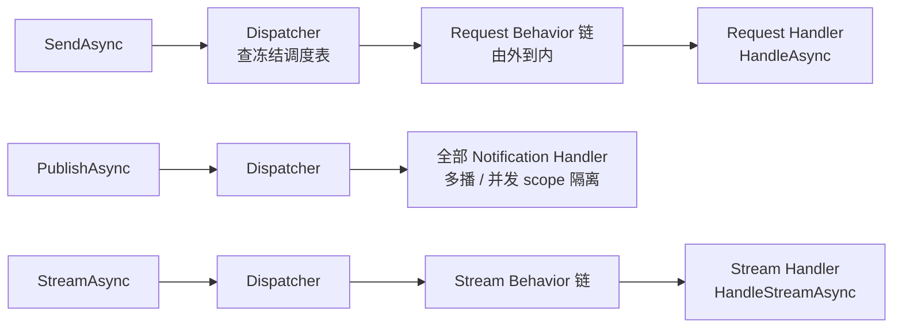

# Conduit — 进程内消息调度库

> **Independent implementation. Not affiliated with or derived from MediatR.**
> 独立实现，Apache-2.0 许可。技术方案见 [`docs/Conduit-类库技术方案.md`](./docs/Conduit-类库技术方案.md)（v3.1）。

## 这是什么

一个面向 .NET 10 的进程内消息调度库：请求 / 响应、通知多播、流式请求、Pipeline Behavior 责任链、
预 / 后处理、异常映射、启动期扫描与诊断、内建 OpenTelemetry。

设计取向是"**零反射热路径 + 零第三方运行时依赖 + 单一 net10.0 资产**"，Native AOT 为第一等目标。

## 30 秒示例

```csharp
public sealed record PingQuery(int Value) : IQuery<int>;

public sealed class PingHandler : IRequestHandler<PingQuery, int>
{
    public ValueTask<int> HandleAsync(PingQuery request, CancellationToken cancellationToken)
        => ValueTask.FromResult(request.Value);
}

var services = new ServiceCollection();
services.AddConduit(cfg =>
{
    cfg.RegisterFromAssemblyContaining<PingQuery>();
    cfg.AddOpenBehavior(typeof(TelemetryBehavior<,>));
});

await using var provider = services.BuildServiceProvider();
var dispatcher = provider.GetRequiredService<IDispatcher>();

var result = await dispatcher.SendAsync(new PingQuery(41));   // 41
```

可运行样例：`dotnet run --project samples/Conduit.Samples`（查询缓存、事务 + 通知、校验短路、流式）。

## 使用指南

### 调用链概览

Conduit 的调用链如下。你的代码只接触最上层的 `ISender` / `IPublisher`，中间的调度、行为链和作用域隔离都藏在库内：



三条链路各自独立：请求走 Request Behavior 链，流走独立的 Stream Behavior 链，通知**不经过** Behavior，而是广播给全部 Handler。

要点：

- 调度表在**启动期**（Mode A 反射扫描）或**编译期**（Mode B 源生成器）构建，热路径只做一次 `FrozenDictionary` 查找，零反射、零 `MakeGenericType`。
- Behavior 按注册顺序**由外到内**包住 Handler，链上调用 `next()` 是无参委托；请求与流的 Behavior 注册表互不混用。
- 并发发布通知时，库为每个 Handler 建独立 scope，避免多个线程共用同一个 `DbContext`。
- Behavior **只能**经 `AddConduit` 配置注册，注册表外的实现会在启动期 fail-fast。

### 前置条件与安装

消费方项目必须是 **`net10.0`**（硬约束：本库只有单一 `net10.0` 资产，不支持 net8/net9/netframework）。

主包已带齐 `Conduit.Contracts`（区间依赖）、Abstractions、Core、DI 运行时程序集，以及 `analyzers/dotnet/cs` 里的源生成器——**装一个包就够**。

```bash
# 从 NuGet.org（发布后）
dotnet add package Conduit

# 从本地构建产物（未发布时）
dotnet add package Conduit --source D:/Projects/Github/Conduit/artifacts

# 可选：FluentValidation 校验适配器
dotnet add package Conduit.FluentValidation
```

只有一种例外：API 项目 / DTO 项目只想暴露消息类型、不想引入调度器时，单独装零依赖的 `Conduit.Contracts`。

### 四种消息形态

| 形态 | 消息接口 | Handler 接口 | 调用方式 |
| --- | --- | --- | --- |
| 请求 / 响应 | `IQuery<T>` 或 `IRequest<T>` | `IRequestHandler<TReq, TRes>.HandleAsync` | `await dispatcher.SendAsync(req)` |
| 命令 | `ICommand`（响应固定为 `Unit`） | 同上，`TRes = Unit` | `await dispatcher.SendAsync(cmd)` |
| 通知（多播） | `INotification` | `INotificationHandler<T>.HandleAsync` | `await dispatcher.PublishAsync(n)` |
| 流式 | `IStreamRequest<T>` | `IStreamRequestHandler<TReq, TRes>.HandleStreamAsync` | `await foreach (var x in dispatcher.StreamAsync(req))` |

消息接口在 `Conduit.Contracts`，Handler / 门面接口在 `Conduit.Abstractions`，注册扩展在 `Conduit.DependencyInjection`。

**三个容易写错的点**：

1. Handler 方法名是 **`HandleAsync`**，不是 `Handle`；流式是 `HandleStreamAsync`。
2. **没有 `SendAsync(IRequest)` 非泛型重载**。`ICommand` 同时实现 `IRequest` 与 `IRequest<Unit>`，直接 `SendAsync(command)` 就推断为 `Unit`。
3. `RequestHandlerDelegate<TResponse>` 是**无参委托**——Behavior 里调用下一环写 `await next()`，不要传 `ct`。

通知允许零个或多个 Handler，全部执行；并发发布时库会为每个 Handler 建独立 scope，不会让两个线程共用同一个 `DbContext`。

### 完整示例：请求、命令、通知、流

```csharp
using Conduit.Abstractions;
using Conduit.Contracts;
using Conduit.DependencyInjection;
using Microsoft.Extensions.DependencyInjection;

// 消息
public sealed record GetProductQuery(string Sku) : IQuery<Product>;
public sealed record CreateOrderCommand(string Sku, int Qty) : ICommand;
public sealed record OrderPlaced(string Sku, int Qty) : INotification;
public sealed record BrowseProducts(int Take) : IStreamRequest<Product>;

// Handler
public sealed class GetProductHandler : IRequestHandler<GetProductQuery, Product>
{
    public ValueTask<Product> HandleAsync(GetProductQuery request, CancellationToken ct)
        => ValueTask.FromResult(new Product(request.Sku));
}

public sealed class CreateOrderHandler : IRequestHandler<CreateOrderCommand, Unit>
{
    private readonly IPublisher _publisher;
    public CreateOrderHandler(IPublisher publisher) => _publisher = publisher;

    public async ValueTask<Unit> HandleAsync(CreateOrderCommand request, CancellationToken ct)
    {
        await _publisher.PublishAsync(new OrderPlaced(request.Sku, request.Qty), ct);
        return Unit.Value;
    }
}

public sealed class AuditHandler : INotificationHandler<OrderPlaced>
{
    public ValueTask HandleAsync(OrderPlaced notification, CancellationToken ct)
    {
        Console.WriteLine($"审计：{notification.Sku} x{notification.Qty}");
        return ValueTask.CompletedTask;
    }
}

public sealed class BrowseHandler : IStreamRequestHandler<BrowseProducts, Product>
{
    public async IAsyncEnumerable<Product> HandleStreamAsync(
        BrowseProducts request, [EnumeratorCancellation] CancellationToken ct)
    {
        for (var i = 0; i < request.Take; i++)
        {
            ct.ThrowIfCancellationRequested();
            yield return new Product($"SKU-{i}");
        }
    }
}

// 注册（Mode A：启动期反射扫描）
var services = new ServiceCollection();
services.AddConduit(cfg => cfg.RegisterFrom(typeof(GetProductQuery).Assembly));

await using var provider = services.BuildServiceProvider(
    new ServiceProviderOptions { ValidateScopes = true });
await using var scope = provider.CreateAsyncScope();

var dispatcher = scope.ServiceProvider.GetRequiredService<IDispatcher>();

Product product = await dispatcher.SendAsync(new GetProductQuery("SKU-1"));
await dispatcher.SendAsync(new CreateOrderCommand("SKU-1", 2));
await foreach (var item in dispatcher.StreamAsync(new BrowseProducts(3)))
{
    Console.WriteLine(item.Sku);
}
```

建议用 `ValidateScopes = true` 构建 Provider，并从显式 scope 解析 `IDispatcher`（默认 Handler 是 Transient，Singleton 需显式审批，见"关键约定"）。

### Behavior 责任链

**注册顺序 = 执行顺序，先注册的在最外层**：

```csharp
services.AddConduit(cfg =>
{
    cfg.RegisterFrom(typeof(GetProductQuery).Assembly);

    // 由外到内：Telemetry → Validation → Transaction → Handler
    cfg.AddOpenBehavior(typeof(TelemetryBehavior<,>));
    cfg.AddOpenBehavior(typeof(ValidationBehavior<,>));
    cfg.AddOpenBehavior(typeof(TransactionBehavior<,>));
});
```

自定义 Behavior 的约束是 `where TRequest : IRequest<TResponse>`：

```csharp
public sealed class TimingBehavior<TRequest, TResponse> : IPipelineBehavior<TRequest, TResponse>
    where TRequest : IRequest<TResponse>
{
    public async ValueTask<TResponse> HandleAsync(
        TRequest request,
        RequestHandlerDelegate<TResponse> next,
        CancellationToken ct)
    {
        var sw = Stopwatch.StartNew();
        var result = await next();          // 无参
        Console.WriteLine($"{typeof(TRequest).Name}: {sw.ElapsedMilliseconds}ms");
        return result;
    }
}

cfg.AddOpenBehavior(typeof(TimingBehavior<,>));
```

**七个内置 Behavior 默认全部关闭**，必须显式注册：`Telemetry` / `Validation` / `Caching` / `Transaction` / `Timeout` / `Retry` / `Idempotency`。它们靠标记接口决定是否作用于某个请求：

| Behavior | 请求需要实现的标记 |
| --- | --- |
| `CachingBehavior` | `ICacheable`（可选 `ICacheKeyProvider` 提供稳定键） |
| `ValidationBehavior` | 任意请求（配合校验适配器） |
| `TransactionBehavior` | `ITransactionalRequest` + 宿主注册 `ITransactionScopeFactory` |
| `TimeoutBehavior` | `ITimeoutRequest` |
| `RetryBehavior` | `IRetryable` 且 `IIdempotent`（重试仅对幂等请求生效） |
| `IdempotencyBehavior` | `IIdempotent` |

强约束：**Behavior 只能通过 `ConduitConfiguration` 注册**。直接 `services.AddTransient<IPipelineBehavior<...>, ...>()` 会在启动期 fail-fast，以保证顺序可判定。

### 异常映射

把异常转成业务响应，或只做告警副作用：

```csharp
public sealed class NotFoundHandler
    : IRequestExceptionHandler<GetProductQuery, Product, KeyNotFoundException>
{
    public ValueTask<ExceptionOutcome<Product>> HandleAsync(
        GetProductQuery request, KeyNotFoundException exception,
        ExceptionOutcome<Product> current, CancellationToken ct)
        => new(ExceptionOutcome<Product>.Handled(Product.Empty));
}

public sealed class AlertAction
    : IRequestExceptionAction<GetProductQuery, Exception>
{
    public ValueTask ExecuteAsync(GetProductQuery request, Exception exception, CancellationToken ct)
    {
        Console.WriteLine($"告警：{exception.Message}");
        return ValueTask.CompletedTask;
    }
}
```

多个 Handler 按"具体到宽泛"顺序推进，任一标记 `Handled` 后停止。`ExceptionActionStrategy` 控制动作是仅对未映射异常执行（默认）还是对所有异常执行。

### FluentValidation 适配器（可选）

```csharp
public sealed class GetProductValidator : AbstractValidator<GetProductQuery>
{
    public GetProductValidator() => RuleFor(x => x.Sku).NotEmpty();
}

services.AddConduit(cfg =>
{
    cfg.RegisterFrom(typeof(GetProductQuery).Assembly);
    cfg.AddFluentValidation();
    cfg.AddOpenBehavior(typeof(ValidationBehavior<,>));   // 让校验真正介入管线
});
```

校验失败抛 `RequestValidationException`，`Errors` 里带 `Identifier` / `Message` / `ErrorCode`。

### 两条注册路径（Mode A / Mode B）

| 模式 | 机制 | 适用 | 入口 |
| --- | --- | --- | --- |
| **Mode A** | 启动期反射扫描一次，构建冻结调度表 | 常规 JIT 宿主 | `services.AddConduit(cfg => cfg.RegisterFrom(...))` |
| **Mode B** | 增量源生成器编译期产出调度表，零反射 | Native AOT / 冷启动敏感 | `services.AddGeneratedConduit(cfg => ...)` |

Mode B 无需额外引用生成器（主包已带 analyzers 资产），只需换入口：

```csharp
using Conduit.Generated;   // AddGeneratedConduit 的命名空间

services.AddGeneratedConduit(cfg =>
{
    // Behavior、发布器、护栏等配置照旧生效
    cfg.AddOpenBehavior(typeof(TelemetryBehavior<,>));
});
```

生成器会给"缺 Handler"等问题报 `CDI001/002/003` 诊断。两种模式的运行期语义完全一致：同一个 `ConduitDispatcher`、同一套 Behavior 语义、同一套诊断。

### 可观测性

库暴露 `ConduitDiagnostics.ActivitySource`（名称取 `Conduit.Core.ConduitDiagnostics.SourceName`）和 `Meter`，send / publish / stream 都会产生 Activity，标签遵循 OTel Messaging 语义。宿主侧订阅并导出到 OTel 后端即可——库本身**不引用任何 OTel 包**，零第三方运行时依赖。

### 建议的阅读顺序

1. 先跑 `samples/Conduit.Samples`：覆盖缓存命中、事务 + 通知、校验短路、流式、可观测性五个场景，是最权威的用法参考。
2. 再对照 [`docs/FEATURES.md`](./docs/FEATURES.md) 的功能矩阵，确认需要的能力是 ✅ 还是 ⛔。
3. 最后看 [`docs/Conduit-类库技术方案.md`](./docs/Conduit-类库技术方案.md) 第 5、6、9 节理解设计边界。

## 解决方案结构

```
src/
  Conduit.Contracts           net10.0   消息形状契约，6 个类型，零依赖
  Conduit.Abstractions        net10.0   Handler / Behavior / Publisher / 门面 / 异常
  Conduit.Core                net10.0   调度内核，仅 BCL（不引 DI 抽象包）
  Conduit.DependencyInjection net10.0   注册、扫描、泛型护栏、启动诊断、作用域隔离
  Conduit.SourceGenerator     netstandard2.0  增量源生成器（Roslyn 宿主约束，以 analyzers 资产并入主包）
  Conduit.FluentValidation    net10.0   可选校验适配包
  Conduit                     net10.0   主 NuGet 包（打包 Abstractions/Core/DI 三个程序集 + 源生成器）
tests/
  Conduit.Tests               规格 / 并发 / DI / 架构合规（TUnit 1.87.12）
  Conduit.GeneratorTests      源生成器端到端 + Roslyn 驱动诊断测试
  Conduit.TestSupport         扫描与负向用例的独立程序集
benchmarks/Conduit.Benchmarks BenchmarkDotNet 基线
samples/Conduit.Samples       可运行示例
scripts/                      合规与基准门禁（.NET 10 File-Based App）
docs/                         技术方案、架构决策、功能对标矩阵
.github/workflows/ci.yaml      CI 流水线
```

依赖方向单向：`Contracts → Abstractions → Core → DependencyInjection`。

## 构建与验证

```bash
dotnet build Conduit.slnx -c Release
dotnet run --project tests/Conduit.Tests -c Release
dotnet run --project tests/Conduit.GeneratorTests -c Release
dotnet run --project samples/Conduit.Samples
dotnet pack src/Conduit/Conduit.csproj -c Release -o artifacts
```

测试栈统一 Microsoft.Testing.Platform（TUnit），不混用 VSTest。
CI 见 `.github/workflows/ci.yaml`：build → test → 合规 → pack → benchmark → AOT smoke。

仓库脚本全部是 .NET 10 File-Based App（单文件 C#，`dotnet run` 直接执行，零 extra 运行时依赖）：

```bash
dotnet run scripts/check_compliance.cs                # 红线 / 依赖 / TFM 合规
dotnet run scripts/check_compliance.cs -- --packages  # 追加 nupkg 结构校验
dotnet run scripts/check_benchmark.cs -- --report <bdn-json>   # 基准回归门禁
```

## 包结构与依赖

| 包 | 内容 | 包依赖 |
| --- | --- | --- |
| `Conduit.Contracts` | `lib/net10.0` 契约程序集 | **无**（零依赖，架构测试断言） |
| `Conduit` | `lib/net10.0` 三个运行时程序集 + `analyzers/dotnet/cs` 源生成器 | `Conduit.Contracts [1.0.0, 2.0.0)`、`Microsoft.Extensions.DependencyInjection.Abstractions` |
| `Conduit.FluentValidation` | 可选适配层 | `Conduit [1.0.0, 2.0.0)`、`FluentValidation` |

主包**不内嵌** `Conduit.Contracts.dll`，契约类型只由契约包提供——从包结构上排除"双包重复定义契约类型"导致的运行时类型不匹配。

## 关键约定（评审可逐条检查）

| 约定 | 落地方式 |
| --- | --- |
| 零第三方运行时依赖 | 架构测试断言 `Contracts` 无包引用、`Core` 无 `Microsoft.Extensions*` |
| 单一 TFM | 架构测试断言所有产品项目只声明 `net10.0`（生成器例外） |
| 契约类型只定义一次 | 架构测试断言 `Conduit.Contracts` 恰好 6 个公开类型 |
| 公开 API 变更需批准 | `PublicApiSurfaceTests` 反射快照比对 `ApiSurface.approved.txt`，签名变动即失败 |
| 无对标库痕迹 | 架构测试全局扫描 `src/`，`MediatR` 零命中 |
| Behavior 顺序可判定 | 只允许经 `ConduitConfiguration` 注册；外部注册直接 fail-fast |
| Singleton 需审查 | 默认拒绝 `Lifetime = Singleton`，需显式 `AllowSingletonLifetime = true` |
| 并行通知不共享 Scoped | 并发发布时每个处理器在独立作用域解析 |

## 与基准的已知差异

详见 [`docs/FEATURES.md`](./docs/FEATURES.md)。要点：

1. **无许可校验机制**（独立库无此概念）。
2. **无 `SendAsync(IRequest)` 非泛型重载**：`ICommand` 同时实现 `IRequest` 与 `IRequest<Unit>`，
   `SendAsync(command)` 直接推断 `Unit`，避免与非泛型重载产生调用二义性。
3. **`CDI001`（缺 Handler）为 Warning 而非 Error**：Handler 可能位于其他程序集，报错会误伤多程序集解决方案。
4. **`Conduit.DependencyInjection` 不声明 AOT 兼容**：反射扫描在设计上依赖运行时元数据，AOT 走 Mode B。

## 许可

Apache-2.0，见 [`LICENSE`](./LICENSE)。
