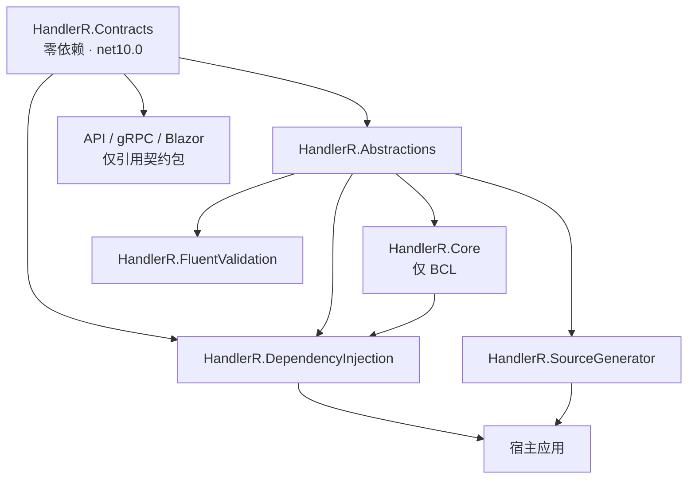

# HandlerR — 基于 .NET 10 原生栈的独立消息调度类库技术方案

| 项     | 内容                                                                                                                                           |
| ----- | -------------------------------------------------------------------------------------------------------------------------------------------- |
| 文档版本  | **v3.1**（干净版：全库统一 `net10.0`，零历史包袱；测试栈锁定 **TUnit 路线**；功能基准仍为 MediatR 15.0.0 + Contracts 2.0.1）                                                |
| 日期    | 2026-11-22                                                                                                                                   |
| 状态    | 待评审（Design Review）                                                                                                                           |
| 命名    | **HandlerR**（工作代号，可替换；不使用任何现有库名）                                                                                                              |
| 目标框架  | **全部产品项目统一 `net10.0` + C# 14**，不提供 netstandard / netframework / 旧 .NET 目标                                                                    |
| 功能基准包 | `dotnet add package MediatR --version 15.0.0`（2026-11-12）<br />`dotnet add package MediatR.Contracts --version 2.0.1`（2023-02-22，Apache-2.0） |

> v3.0 相对 v2.2 的实质变更：**砍掉全部跨目标兼容设计**——契约层不再双目标，删除 TypeForwardings、ApiCompat 跨目标一致性、polyfill 与条件编译。全库只编译一个 `net10.0` 资产，可无约束使用 .NET 10 BCL 与 C# 14。
>
> **"对齐"仅指功能覆盖与语义等价，不是 API 兼容、不是 TFM 兼容、不是代码复用**——见第 1.2 节独立性红线与第 2.4 节豁免。

> v3.1 相对 v3.0 的变更：**测试栈选定 TUnit 路线**（TUnit 1.87.12 + TUnit.Assertions + TUnit.Mocks + Microsoft.Testing.Platform），放弃 xUnit v3 + AwesomeAssertions 备选。理由：与 HandlerR 的"源生成 + AOT + 零反射"架构哲学一致，AOT 实测性能显著领先。
>
> v1.0 文档（`MediatR-重写技术方案.md`）基于"API 同构 / 兼容替换"思路，已因目标变更而废弃，仅作历史参考。

---

## 0. 先回答：MediatR 从哪个版本修改开源协议

| 版本线             | 时间                     | 许可                                                              |
| --------------- | ---------------------- | --------------------------------------------------------------- |
| ≤ **12.5.0**    | 2025-04-01 发布（最后一个开源版） | **Apache-2.0**，可永久继续使用，但无安全更新与商业支持                              |
| ≥ **13.0.0**    | 2025-07-02 发布          | **RPL-1.5（Reciprocal Public License 1.5）+ Lucky Penny 商业许可**双许可 |
| 14.x / 15.x（当前） | —                      | 同上双许可                                                           |

要点：

- **RPL-1.5 是互惠型许可（copyleft）**：对外分发时需承担开放相应源码的义务，多数企业法务不接受。
- **Community 免费层**要求年收入 < 500 万美元、外部融资 < 1000 万美元、非政府/非高校机构——中大型企业不满足。
- 商业许可按团队规模分档，Standard（1–10 名开发者）约 489 美元/年起。
- 唯一仍为 Apache-2.0 的子包是 `MediatR.Contracts`。

**对本项目的意义**：既然目标是"借鉴思想、独立实现"，许可问题从根本上被规避——HandlerR 不引用上述任何一个包，许可采用 Apache-2.0，与 MediatR 无任何法律或技术关联。

### 0.1 功能基准：MediatR 15.0.0 实际能力面

核实结果（基于此版本 NuGet 包与 v15.0.0 源码树）：

| 项       | MediatR 15.0.0                                                                                                                                                                                                                                      |
| ------- | --------------------------------------------------------------------------------------------------------------------------------------------------------------------------------------------------------------------------------------------------- |
| 发布日期    | 2026-11-12（当前最新稳定版）                                                                                                                                                                                                                                 |
| 目标框架    | `net10.0` / `net11.0` / `netstandard2.0` / `net462`；**已移除 net8.0 / net9.0**                                                                                                                                                                         |
| 依赖      | `MediatR.Contracts >= 2.0.1 <3.0.0`、`Microsoft.Extensions.DependencyInjection.Abstractions >=10.0`、`Microsoft.Extensions.Logging.Abstractions >=10.0`、`Microsoft.IdentityModel.JsonWebTokens >=8.14`（许可校验用）                                         |
| 支持策略    | 安全修复仅覆盖 15.x / 14.x；**13.x 已停止支持**                                                                                                                                                                                                                  |
| **契约包** | **`MediatR.Contracts 2.0.1`**（2023-02-22 发布，**Apache-2.0**，仅 `netstandard2.0`，**零依赖**）；主包以 `[2.0.1, 3.0.0)` 区间依赖它                                                                                                                                   |
| 源码结构    | 主包：`Entities`(OpenBehavior) / `Internal` / `Licensing` / `MicrosoftExtensionsDI` / `NotificationPublishers` / `Pipeline` / `Registration` / `Wrappers`；契约包：`IBaseRequest.cs` / `IRequest.cs` / `INotification.cs` / `IStreamRequest.cs` / `Unit.cs` |

**13.0 → 15.0 的实质变化**（决定本次"对齐"的重点）：

| 版本   | 变化                                                                                                             | 是否属于 HandlerR 对齐范围              |
| ---- | -------------------------------------------------------------------------------------------------------------- | ------------------------------ |
| 13.0 | 许可 key 机制、netstandard2.0 回归、开放 Behavior 多注册、Timeout behavior、`CancellationToken` 全链传递、泛型 Handler 自动注册改为 opt-in | 部分：✅ 注册/令牌/超时对齐；❌ 许可机制不对齐      |
| 13.1 | 静态 license key、.NET 4.x 一等支持、LightInject/StashBox/Lamar 容器测试                                                   | ❌ 许可/多框架；✅ 多容器解耦思想             |
| 14.0 | 升级 .NET 10、NuGet 包签名                                                                                           | ✅ 包签名（内部 feed）；框架以 net10 为唯一基线 |
| 14.1 | **嵌套泛型参数处理**、**F# 程序集反射容错**、**通知 Handler 去重**、**perpetual license**                                            | ✅ 前三项对齐；❌ 许可                   |
| 14.2 | license 环境变量 fallback、许可校验移出 Mediator 构造路径、空 key 处理                                                            | ❌ 许可机制                         |
| 14.3 | **从泛型约束推断开放 Behavior 类型参数**、链式约束推断、`LicenseKeyFactory` from DI                                                 | ✅ 前两项对齐；❌ 许可                   |
| 15.0 | `MaxGenericTypeRegistrations` / `RegistrationTimeout` 设为 `0` 可禁用限制、文档迁移                                        | ✅ 对齐                           |

> **关键结论**：15.0 **没有新增消息模型接口**（无新的 `IRequest` 变体、无新的 Handler 形态）。它的差异集中在**配置面、注册语义与边界行为**。因此"全面对齐 15.0"不等于"抄接口清单"，而是要把第 2.1 节的完整配置面与注册语义逐项实现。——这是功能基准的核心结论；v3.0 在此基础上进一步收敛为纯 `net10.0` 实现。

---

## 1. 目标、边界与独立性红线

### 1.1 目标

1. **借鉴设计思想**：进程内请求/响应、通知多播、Pipeline Behavior 责任链、流式请求、预/后处理、异常映射、启动期扫描注册——这些是模式思想，不受版权保护。
2. **完全独立实现**：全部代码从零编写，不复制、不改写、不翻译任何 MediatR 源码；类型命名、API 形状、内部机制均独立设计。
3. **全量功能对标**：覆盖 MediatR 的全部能力面，并在可观测性、AOT、诊断、横切能力上做增强。
4. **彻底使用 .NET 10 原生栈**：`FrozenDictionary`、`ValueTask`、`IAsyncEnumerable`、`ActivitySource`/`Meter`、`IIncrementalGenerator`、Native AOT；运行时零第三方依赖。

### 1.2 独立性红线（硬性，代码评审逐条检查）

| # | 红线                                                                                                                                                                                                                                    | 检查方式                                               |
| - | ------------------------------------------------------------------------------------------------------------------------------------------------------------------------------------------------------------------------------------- | -------------------------------------------------- |
| 1 | 不引用 `MediatR`、`MediatR.Contracts`、`MediatR.Extensions.*` 任何包，**包括传递依赖**                                                                                                                                                               | `dotnet list package --include-transitive` 输出中不得出现 |
| 2 | 不复制/改写/翻译 MediatR 源码；实现从零编写                                                                                                                                                                                                           | 代码评审 + 相似度扫描（如 `dotnet format` 风格一致性 + 人工复核）       |
| 3 | 不使用 MediatR 的命名空间、程序集名、**独有类型名**（`Mediator` / `IMediator` / `MediatRServiceConfiguration` / `ForeachAwaitPublisher` 等）、商标；**模式通用名**（`IRequest` / `IRequest<T>` / `INotification` / `IStreamRequest<T>` / `Unit` / `IBaseRequest`）允许使用 | 全局搜索 `MediatR` 应为 0 命中（历史文档除外）                     |
| 4 | 文档/注释不得出现 "drop-in replacement"、"compatible with MediatR" 等混淆性表述                                                                                                                                                                      | 文档评审                                               |
| 5 | **测试不做 API 等价性双跑**；改用行为规格测试 + 功能覆盖矩阵                                                                                                                                                                                                  | 测试代码评审                                             |
| 6 | 不从 MediatR 的 issue/PR 直接摘代码（可阅读思想）                                                                                                                                                                                                    | 代码评审                                               |
| 7 | 生态适配包（FluentValidation 等）全部自行实现                                                                                                                                                                                                       | 项目结构检查                                             |
| 8 | README 明确声明："Independent implementation. Not affiliated with or derived from MediatR."                                                                                                                                                | 发布前检查                                              |

> 思想借鉴与代码复制的边界是关键：**Canon 规则、CQRS 模式、责任链、泛型约束筛选属于通用工程思想；具体的接口声明、文件组织、注释、实现细节属于表达。** HandlerR 只取前者。

---

## 2. 全量功能对标矩阵（基准：MediatR 15.0.0）

状态说明：**✅ 对齐**（功能与语义等价，API 形状独立）、**⬆️ 增强**（超出基准）、**⛔ 有意不对齐**（商业/多框架包袱，见说明）。

### 2.1 消息模型与分发

| #  | MediatR 15.0.0                                                                                      | HandlerR                                                                      | 状态 | 说明                                                                 |
| -- | --------------------------------------------------------------------------------------------------- | ---------------------------------------------------------------------------- | -- | ------------------------------------------------------------------ |
| 1  | `IRequest` / `IRequest<T>` / `Unit`                                                                 | `IRequest` / `IRequest<T>` / `Unit`                                          | ✅  | 语义一致                                                               |
| 2  | `IRequestHandler<T>` / `IRequestHandler<T,R>`                                                       | `IRequestHandler<T,R>`（无返回值统一 `Unit`）                                        | ✅  | 方法名 `HandleAsync`                                                  |
| 3  | —                                                                                                   | `ICommand` / `IQuery<T>` 语义标记                                                | ⬆️ | 用于按命令/查询筛选 Behavior                                                |
| 4  | `ISender.Send`                                                                                      | `ISender.SendAsync`                                                          | ✅  | —                                                                  |
| 5  | `IMediator`（同时实现 ISender/IPublisher）                                                                | `IDispatcher : ISender, IPublisher`                                          | ✅  | 名称独立                                                               |
| 6  | `INotification` / `INotificationHandler<T>`                                                         | 同名语义接口                                                                       | ✅  | —                                                                  |
| 7  | `IPublisher.Publish`                                                                                | `IPublisher.PublishAsync`                                                    | ✅  | —                                                                  |
| 8  | `INotificationPublisher`（可替换）                                                                       | `INotificationPublisher`                                                     | ✅  | 必须可替换，不能锁死为枚举                                                      |
| 9  | `ForeachAwaitPublisher` / `TaskWhenAllPublisher`                                                    | `SequentialPublisher` / `ParallelPublisher` / `AggregatingParallelPublisher` | ⬆️ | 多第三种异常聚合策略                                                         |
| 10 | 通知 Handler 去重（14.1 引入）                                                                              | 扫描期去重 + 运行期 executor 去重                                                      | ✅  | 避免同一 Handler 被调用两次                                                 |
| 11 | `IStreamRequest<T>` / `IStreamRequestHandler<T,R>`                                                  | 同名语义接口                                                                       | ✅  | —                                                                  |
| 12 | `IStreamPipelineBehavior<T,R>`                                                                      | 同名语义接口                                                                       | ✅  | 独立 Stream 链，不与 Request 混用                                          |
| 13 | `IPipelineBehavior<T,R>` / `RequestHandlerDelegate<T>`                                              | 同名语义接口 + 委托                                                                  | ✅  | 逆序 fold 责任链                                                        |
| 14 | 开放 Behavior 多注册（13.0 引入）                                                                            | `UseOpenBehavior(...)` 支持多次注册                                                | ✅  | —                                                                  |
| 15 | `OpenBehavior`（Type + Lifetime）                                                                     | `HandlerROpenBehavior`（Type + Lifetime）                                       | ✅  | 类型名独立                                                              |
| 16 | 从泛型约束推断开放 Behavior 类型参数（14.3）、链式约束推断                                                                | 同语义推断器                                                                       | ✅  | 支持 `Behavior<TReq,TItem> : IPipelineBehavior<TReq,List<TItem>>` 形态 |
| 17 | `OpenBehaviorClosingStrategy` = `CloseForScannedRequests` / `CloseInContainer`                      | `BehaviorClosingStrategy` 同名两值                                               | ✅  | 保留容器差异语义                                                           |
| 18 | 泛型约束筛选（`where TRequest : ICacheable`）                                                               | DI 判定生效范围 + 内置标记接口                                                           | ✅  | —                                                                  |
| 19 | `IRequestPreProcessor<T>` / `IRequestPostProcessor<T,R>`                                            | 同名语义接口                                                                       | ✅  | 链条外执行                                                              |
| 20 | `IRequestExceptionHandler<T,R,TE>` + `RequestExceptionHandlerState<T>`                              | 同名语义接口 + `ExceptionOutcome<T>`                                               | ✅  | 状态机语义等价，类型名独立                                                      |
| 21 | `IRequestExceptionAction<T,TE>`                                                                     | `IRequestExceptionAction<T,TE>`                                              | ✅  | —                                                                  |
| 22 | `RequestExceptionActionProcessorStrategy` = `ApplyForUnhandledExceptions` / `ApplyForAllExceptions` | `ExceptionActionStrategy` 同名两值                                               | ✅  | 默认对齐 `ApplyForUnhandledExceptions`                                 |
| 23 | `CancellationToken` 全链传递（13.0 引入）                                                                   | 全链路透传                                                                        | ✅  | —                                                                  |

### 2.2 配置面与注册语义（15.0 对齐重点）

完整配置属性逐项对齐，见 **2.3 节配置面对照表**。

| #  | MediatR 15.0.0                                                                                                 | HandlerR                                                         | 状态 | 说明                         |
| -- | -------------------------------------------------------------------------------------------------------------- | --------------------------------------------------------------- | -- | -------------------------- |
| 24 | `RegisterServicesFromAssembly` / `Assemblies` / `AssemblyContaining<T>`                                        | `RegisterFrom(...)` 同名语义重载                                      | ✅  | —                          |
| 25 | `TypeEvaluator` 类型过滤器                                                                                          | `TypeEvaluator`                                                 | ✅  | 默认 `t => true`             |
| 26 | `Lifetime`（默认 `Transient`）                                                                                     | `Lifetime`（默认 `Transient`，**禁止 Singleton 与 Scoped Handler 混用**） | ✅  | 见 7.2 生命周期修正               |
| 27 | `MediatorImplementationType`                                                                                   | `DispatcherImplementationType`                                  | ✅  | 允许自定义实现类型                  |
| 28 | `NotificationPublisher` 实例 / `NotificationPublisherType` 类型                                                    | 同名语义双属性                                                         | ✅  | 类型属性覆盖实例属性                 |
| 29 | `AutoRegisterRequestProcessors`                                                                                | 同名语义                                                            | ✅  | 默认 `false`                 |
| 30 | `AddBehavior` / `AddStreamBehavior` / `AddRequestPreProcessor` / `AddRequestPostProcessor` / `AddOpenBehavior` | 同名语义扩展方法                                                        | ✅  | 显式注册，扫描不自动注册 Behavior      |
| 31 | `RegisterGenericHandlers`（默认 `false`，opt-in）                                                                   | 同名语义                                                            | ✅  | 泛型 Handler 默认不自动注册         |
| 32 | `MaxGenericTypeParameters`（默认 10）                                                                              | 同名语义                                                            | ✅  | —                          |
| 33 | `MaxTypesClosing`（默认 100）                                                                                      | 同名语义                                                            | ✅  | —                          |
| 34 | `MaxGenericTypeRegistrations`（默认 125000）                                                                       | 同名语义                                                            | ✅  | —                          |
| 35 | `RegistrationTimeout`（默认 15000 ms）                                                                             | 同名语义                                                            | ✅  | —                          |
| 36 | **设为 `0` 禁用上述限制**（15.0 修复）                                                                                     | 同样语义                                                            | ✅  | 0 表示禁用，不是立即失败              |
| 37 | **嵌套泛型参数处理**（14.1）                                                                                             | 扫描器支持嵌套泛型实参                                                     | ✅  | —                          |
| 38 | **F# 程序集反射容错**（14.1）                                                                                           | 扫描器捕获反射异常并跳过不可读类型                                               | ✅  | —                          |
| 39 | 需 `ILoggerFactory` 才能解析 `IMediator`                                                                            | 不要求；用 `ActivitySource`/`Meter`                                  | ⬆️ | 降低宿主依赖，消除"缺 Logger 即崩"     |
| 40 | 依赖 `Microsoft.IdentityModel.JsonWebTokens` 做许可校验                                                               | 零第三方依赖                                                          | ⬆️ | 依赖面从 4 个降为 0               |
| 41 | `MediatR.Contracts 2.0.1` 独立契约包（零依赖 / 6 类型）                                                                    | `HandlerR.Contracts 1.0` 对应                                      | ✅  | 详见 **2.5 契约包对齐**           |
| 42 | 契约包 `netstandard2.0` 目标                                                                                        | `HandlerR.Contracts` 仅 `net10.0`                                 | ⛔  | 无历史包袱，不做跨目标兼容（2.4 / 2.5.3） |

### 2.3 配置面对照表（MediatRServiceConfiguration → HandlerRConfiguration）

| MediatR 15.0 属性                                                                                                            | 默认值                           | HandlerR 对应                      | 默认值                         | 备注             |
| -------------------------------------------------------------------------------------------------------------------------- | ----------------------------- | ------------------------------- | --------------------------- | -------------- |
| `TypeEvaluator`                                                                                                            | `t => true`                   | `TypeEvaluator`                 | `t => true`                 | —              |
| `MediatorImplementationType`                                                                                               | `typeof(Mediator)`            | `DispatcherImplementationType`  | `typeof(HandlerRDispatcher)` | —              |
| `NotificationPublisher`                                                                                                    | `new ForeachAwaitPublisher()` | `NotificationPublisher`         | `new SequentialPublisher()` | —              |
| `NotificationPublisherType`                                                                                                | `null`                        | `NotificationPublisherType`     | `null`                      | 优先级高于实例        |
| `Lifetime`                                                                                                                 | `Transient`                   | `Lifetime`                      | `Transient`                 | 启动期禁止危险组合      |
| `RequestExceptionActionProcessorStrategy`                                                                                  | `ApplyForUnhandledExceptions` | `ExceptionActionStrategy`       | 同左                          | —              |
| `OpenBehaviorClosingStrategy`                                                                                              | `CloseForScannedRequests`     | `BehaviorClosingStrategy`       | 同左                          | —              |
| `AutoRegisterRequestProcessors`                                                                                            | `false`                       | `AutoRegisterRequestProcessors` | `false`                     | —              |
| `MaxGenericTypeParameters`                                                                                                 | `10`                          | 同左                              | `10`                        | `0` 禁用         |
| `MaxTypesClosing`                                                                                                          | `100`                         | 同左                              | `100`                       | `0` 禁用         |
| `MaxGenericTypeRegistrations`                                                                                              | `125000`                      | 同左                              | `125000`                    | `0` 禁用         |
| `RegistrationTimeout`                                                                                                      | `15000` ms                    | 同左                              | `15000` ms                  | `0` 禁用         |
| `RegisterGenericHandlers`                                                                                                  | `false`                       | 同左                              | `false`                     | —              |
| `LicenseKey` / `LicenseKeyFactory`                                                                                         | —                             | **⛔ 不提供**                       | —                           | 商业许可机制，独立库无此概念 |
| `BehaviorsToRegister` / `StreamBehaviorsToRegister` / `RequestPreProcessorsToRegister` / `RequestPostProcessorsToRegister` | 空列表                           | 同名语义有序列表                        | 空列表                         | 顺序 = 由外到内      |


### 2.4 有意不对齐（明确豁免）

| 基准能力                                                                             | 不对齐原因                                                        |
| -------------------------------------------------------------------------------- | ------------------------------------------------------------ |
| LicenseKey / LicenseKeyFactory / 环境变量 fallback / perpetual license / 后台线程校验      | 商业许可执行机制，HandlerR 为 Apache-2.0 独立库，无许可校验需求                           |
| **全部非 `net10.0` 目标**（`net11.0` / `netstandard2.0` / `netstandard2.1` / `net462`） | **v3.0 全库只做 `net10.0`**。无历史包袱、无跨目标资产、无条件编译、无 polyfill（2.5.3） |
| 跨进程消息 / Outbox / Inbox / Saga                                                    | 消息总线职责，非进程内调度器定位                                             |
| 面向 MediatR 的兼容垫片、类型转发、迁移工具                                                       | **全部不做**。与"无任何关系"目标冲突；v3.0 也不做自有类型转发——无历史代码需要兼容              |
| NuGet 多资产发布（同一包含多个 TFM）                                                          | 只发布单一 `net10.0` 资产，包体最小、依赖图最简单                               |
| 强制 `Result<T>` 错误模型                                                              | 本方案只做异常映射，不推动业务错误处理体系改造                                      |

> 补充说明：**NuGet 包签名对齐基准 14.0 起的企业级能力**（内部 feed 启用签名，见第 11 节），不属于豁免项。

### 2.5 契约包对齐（MediatR.Contracts 2.0.1 → HandlerR.Contracts 1.0）

**核实到的基准事实**：2.0.1 发布于 2023-02-22，许可证 Apache-2.0，仅 `netstandard2.0`、零依赖，包描述 "Contracts package for requests, responses, and notifications"，只放 6 个公开类型。HandlerR **只借鉴"把消息形状单独拆包"这个设计决策**，不继承它的 TFM、类型转发或存量兼容机制（v3.0 无历史包袱）。

#### 2.5.1 类型逐个对齐

| #  | MediatR.Contracts 2.0.1                                                                                                                                                                                  | HandlerR.Contracts 1.0                    | 状态              |
| -- | -------------------------------------------------------------------------------------------------------------------------------------------------------------------------------------------------------- | ---------------------------------------- | --------------- |
| 1  | `IBaseRequest`（非泛型标记，用于泛型约束）                                                                                                                                                                             | `IBaseRequest`                           | ✅               |
| 2  | `IRequest : IBaseRequest`（无响应请求）                                                                                                                                                                         | `IRequest : IBaseRequest`                | ✅               |
| 3  | `IRequest<out TResponse> : IBaseRequest`                                                                                                                                                                 | `IRequest<out TResponse> : IBaseRequest` | ✅               |
| 4  | `INotification`（一对多通知标记）                                                                                                                                                                                 | `INotification`                          | ✅               |
| 5  | `IStreamRequest<out TResponse>`（流式请求标记）                                                                                                                                                                  | `IStreamRequest<out TResponse>`          | ✅               |
| 6  | `Unit`：`readonly struct`，实现 `IEquatable<Unit>` / `IComparable<Unit>` / `IComparable`，含 `Value`（`static ref readonly`）、`Task`（静态缓存 `Task.FromResult`）、`CompareTo`、`Equals`、`==`/`!=`、`ToString() => "()"` | `Unit` 完整实现同一成员集合，独立编写                   | ✅               |
| 7  | 零依赖                                                                                                                                                                                                      | 零依赖                                      | ✅               |
| 8  | 仅 `netstandard2.0`                                                                                                                                                                                       | **仅 `net10.0`**                          | ⛔ 有意不对齐，见 2.5.3 |
| 9  | Apache-2.0                                                                                                                                                                                               | Apache-2.0                               | ✅ 同协议，独立声明      |
| 10 | 主包用 `TypeForwardedTo` 转发契约类型（存量兼容）                                                                                                                                                                       | **不做类型转发**                               | ⛔ 无历史代码需要兼容     |

> `Unit` 的完整成员集合是本次对齐的重点——v2.1 草稿里我只写了 `Equals`/`GetHashCode`/运算符，**缺 `IComparable<Unit>`、`IComparable.CompareTo`、`static Task` 与 `ref readonly Value`**。这些成员在排序、缓存键、异步无返回值路径上有真实用途，必须补齐。

#### 2.5.2 包拆分与职责边界

```
HandlerR.Contracts          net10.0   零依赖
  IBaseRequest / IRequest / IRequest<T> / INotification / IStreamRequest<T> / Unit
  → 只放"消息形状"，不放 Handler / Behavior / DI / 分发逻辑

HandlerR.Abstractions       net10.0
  引用 HandlerR.Contracts（自有包，非第三方）
  ICommand / IQuery<T> / IRequestHandler / INotificationHandler / IStreamRequestHandler
  IPipelineBehavior / IStreamPipelineBehavior / Pre/Post / 异常映射 / 校验 / ISender / IPublisher / IDispatcher

HandlerR.Core               net10.0
HandlerR.DependencyInjection net10.0
HandlerR.FluentValidation   net10.0
HandlerR.SourceGenerator    netstandard2.0（*仅 Roslyn 分析器宿主约束，非产品目标框架，见 2.5.3）
```

拆分收益：

- **API / gRPC / Blazor 契约项目可只引用 `HandlerR.Contracts`**，不拉取调度器、DI 与可观测性代码（这些项目本身须为 `net10.0`）。
- 契约程序集独立版本化，主包精确依赖 `HandlerR.Contracts [1.0.0, 2.0.0)`。
- 没有类型转发层，类型只在契约包定义一次，依赖图是单向直线。

#### 2.5.3 目标框架策略：全库统一 `net10.0`

**v3.0 决策：所有产品项目只编译一个 `net10.0` 资产。不提供 netstandard2.0 / netstandard2.1 / net462 / net11.0，不做多目标，不做条件编译，不做 polyfill。**

```xml

<Project Sdk="Microsoft.NET.Sdk">
  <PropertyGroup>
    <TargetFramework>net10.0</TargetFramework>
    <LangVersion>14.0</LangVersion>
    <Nullable>enable</Nullable>
    <ImplicitUsings>enable</ImplicitUsings>
    <TreatWarningsAsErrors>true</TreatWarningsAsErrors>
    <IsAotCompatible>true</IsAotCompatible>
    <PackageId>HandlerR.Contracts</PackageId>
    <Description>Contracts package for requests, responses, and notifications.</Description>
    <PackageLicenseExpression>Apache-2.0</PackageLicenseExpression>
    <GenerateDocumentationFile>true</GenerateDocumentationFile>
  </PropertyGroup>
</Project>
```

**这样换来的东西（这是 v3.0 的核心价值）：**

| 收益                | 说明                                                                                                                                                                                                                                             |
| ----------------- | ---------------------------------------------------------------------------------------------------------------------------------------------------------------------------------------------------------------------------------------------- |
| **零第三方依赖真正成立**    | 不需要 `System.Threading.Tasks.Extensions`（补 ValueTask）、`Microsoft.Bcl.AsyncInterfaces`（补 IAsyncEnumerable）、`System.Diagnostics.DiagnosticSource`（补 ActivitySource/Meter）、`System.Collections.Immutable`（补 FrozenDictionary）。全部用 .NET 10 BCL 原生类型 |
| **单一公开 API**      | 只有一个资产，不存在跨 TFM 签名分裂，`ApiCompat` / PublicApiAnalyzers 跨目标校验不再需要                                                                                                                                                                                |
| **C# 14 全量可用**    | `extension` 块、`field` 关键字、`nameof(List<>)` 不受 TFM 限制，无需 `#if` 条件编译                                                                                                                                                                             |
| **Native AOT 成立** | 单一 net10.0 资产 + 源生成器路径，无反射、无裁剪警告                                                                                                                                                                                                               |
| **依赖图与包体最小**      | 无多资产、无兼容垫片、无 polyfill 层                                                                                                                                                                                                                        |

**唯一例外：`HandlerR.SourceGenerator` 项目目标 `netstandard2.0`。**

这不是产品目标框架，而是 Roslyn 分析器宿主的硬性约束——`IIncrementalGenerator` 由编译器加载，编译器本身运行在 netstandard2.0 兼容的分析器宿主中，所有 Roslyn 分析器/源生成器项目必须以 netstandard2.0 为目标（这是生态通行做法，不是历史包袱）。该项目：

- 不发布为运行时依赖，仅在编译期由编译器加载；
- 不引用任何 HandlerR 运行时包，只引用 `Microsoft.CodeAnalysis.*`；
- 产物不进入应用的运行时依赖图，不影响 AOT 与包体。

**已删除的兼容机制（v2.2 → v3.0）：**

| 删除项                                          | 原因           |
| -------------------------------------------- | ------------ |
| 契约层 `net10.0;netstandard2.0` 双目标             | 无跨目标消费方      |
| `ApiCompat` 跨目标 API 一致性校验                    | 只有一个资产，无可比对象 |
| `TypeForwardings.cs` 与 6 条 `TypeForwardedTo` | 无存量代码需要兼容    |
| `#if NET10_0` 条件编译块                          | 无多目标分支       |
| C# 14 语法"仅 net10 块可用"的限制                     | 全库都是 net10   |
| `ValueTask` polyfill 相关依赖与讨论                 | net10 BCL 原生 |

#### 2.5.4 合规边界

`MediatR.Contracts 2.0.1` 是 Apache-2.0，**法律上允许引用**，但按独立性红线 #1 我们**不引用、不复制**：只对齐"包边界 + 类型职责 + 成员集合"这三项设计决策，`Unit` 的实现代码自行编写。CI 架构合规测试断言：`HandlerR.Contracts` 依赖列表为空、解决方案中无 `MediatR*` PackageReference、**所有产品项目 `TargetFramework` 必须为 `net10.0`**（源生成器项目除外）。

---

## 3. 总体架构

### 3.1 项目结构

```
HandlerR.Contracts             net10.0   零依赖，6 个契约类型 + Unit
HandlerR.Abstractions          net10.0   引用 Contracts；Handler / Pipeline / 门面
HandlerR.Core                  net10.0   调度内核，仅依赖 Abstractions + BCL
HandlerR.DependencyInjection   net10.0   DI 扩展、程序集扫描、启动期诊断
HandlerR.SourceGenerator       netstandard2.0* IIncrementalGenerator（*Roslyn 宿主约束，非产品 TFM）
HandlerR.FluentValidation      net10.0   可选适配包（自研，不依赖 MediatR 集成包）
HandlerR.Tests                 net10.0   单元 / 规格 / 并发 / 架构合规
HandlerR.Benchmarks            net10.0   BenchmarkDotNet 基线
HandlerR.Samples               net10.0   Minimal API + EF Core 10 示例

全部产品项目单一 net10.0 资产；唯一例外是源生成器（编译器加载器要求），不进入运行时依赖图。
```

**依赖方向**：



**关键设计决策**：`HandlerR.Core` **不引用** `Microsoft.Extensions.DependencyInjection.Abstractions`，只接收 `IServiceProvider`（`System` 原生类型）。DI 是宿主侧关注点，内核保持纯 BCL，便于单测与非 DI 场景使用。

### 3.2 双模注册（Mode A / Mode B）

| 模式                               | 机制                                | 适用                   | 代价             |
| -------------------------------- | --------------------------------- | -------------------- | -------------- |
| **Mode A：扫描 + FrozenDictionary** | 启动期反射扫描一次，构建 wrapper 与调度表         | MVP、JIT 宿主           | AOT 下需显式注册清单   |
| **Mode B：增量源生成器**                | 编译期生成调度表与 `AddGeneratedHandlerR()` | Native AOT、容器冷启动敏感场景 | 生成器调试成本高 3~5 倍 |

**纪律**：先用 Mode A 把行为语义用测试钉死，再让 Mode B 只做"把已验证行为搬到编译期"。不并行开发生成器。

---

## 4. 契约层完整设计（HandlerR.Contracts + HandlerR.Abstractions）

### 4.1 HandlerR.Contracts：6 个类型，零依赖

```csharp
namespace HandlerR.Contracts;

// 标记接口（对齐 Contracts 2.0.1 的职责边界：只描述消息形状）
public interface IBaseRequest { }
public interface IRequest : IBaseRequest { }                 // 无响应请求
public interface IRequest<out TResponse> : IBaseRequest { }   // 有响应请求
public interface INotification { }                            // 一对多通知
public interface IStreamRequest<out TResponse> { }            // 流式请求

// Unit 完整实现（v2.1 草稿缺 IComparable / Task / ref readonly Value，此处补齐）
public readonly struct Unit : IEquatable<Unit>, IComparable<Unit>, IComparable
{
    private static readonly Unit _value = new();

    public static ref readonly Unit Value => ref _value;
    public static Task Task { get; } = System.Threading.Tasks.Task.FromResult(_value);

    public int CompareTo(Unit other) => 0;
    int IComparable.CompareTo(object? obj) => 0;

    public override int GetHashCode() => 0;
    public bool Equals(Unit other) => true;
    public override bool Equals(object? obj) => obj is Unit;
    public static bool operator ==(Unit first, Unit second) => true;
    public static bool operator !=(Unit first, Unit second) => false;
    public override string ToString() => "()";
}
```

> `IMessage` 标记在 v2.1 中引入，但它破坏契约包与基准的严格对等（`IBaseRequest` 应为无基接口）。**v2.2 移除 `IMessage`**，通知与请求的顶层标记回归 `IBaseRequest` / `INotification`。

### 4.2 HandlerR.Abstractions：依赖 Contracts，承载行为契约

```csharp
namespace HandlerR.Abstractions;

using HandlerR.Contracts;

// 语义标记（HandlerR 增强，不属于基准契约包）
public interface ICommand : IRequest, IRequest<Unit>;           // 命令
public interface IQuery<out TResponse> : IRequest<TResponse>;   // 查询

// ——— Handler ———
public interface IRequestHandler<in TRequest, TResponse>
    where TRequest : IRequest<TResponse>
{
    ValueTask<TResponse> HandleAsync(TRequest request, CancellationToken ct);
}

public interface INotificationHandler<in TNotification>
    where TNotification : INotification
{
    ValueTask HandleAsync(TNotification notification, CancellationToken ct);
}

public interface IStreamRequestHandler<in TRequest, out TResponse>
    where TRequest : IStreamRequest<TResponse>
{
    IAsyncEnumerable<TResponse> HandleStreamAsync(TRequest request, CancellationToken ct);
}

// ——— Pipeline ———
public delegate ValueTask<TResponse> RequestHandlerDelegate<TResponse>();
public delegate IAsyncEnumerable<TResponse> StreamHandlerDelegate<TResponse>();

public interface IPipelineBehavior<in TRequest, TResponse>
    where TRequest : IRequest<TResponse>
{
    ValueTask<TResponse> HandleAsync(
        TRequest request, RequestHandlerDelegate<TResponse> next, CancellationToken ct);
}

public interface IStreamPipelineBehavior<in TRequest, TResponse>
    where TRequest : IStreamRequest<TResponse>
{
    IAsyncEnumerable<TResponse> HandleStreamAsync(
        TRequest request, StreamHandlerDelegate<TResponse> next, CancellationToken ct);
}

// ——— 通知发布策略（可替换） ——–
public readonly record struct NotificationHandlerExecutor(
    Func<INotification, CancellationToken, ValueTask> Handler);

public interface INotificationPublisher
{
    ValueTask PublishAsync(
        IReadOnlyList<NotificationHandlerExecutor> handlers,
        INotification notification,
        CancellationToken ct);
}

// ——— 前/后处理器 ———
public interface IRequestPreProcessor<in TRequest> where TRequest : IBaseRequest
{
    ValueTask ProcessAsync(TRequest request, CancellationToken ct);
}

public interface IRequestPostProcessor<in TRequest, in TResponse>
    where TRequest : IRequest<TResponse>
{
    ValueTask ProcessAsync(TRequest request, TResponse response, CancellationToken ct);
}

// ——— 异常映射 ———
public enum ExceptionHandlingState { Unhandled, Handled }

public readonly record struct ExceptionOutcome<TResponse>(
    ExceptionHandlingState State, TResponse? Response)
{
    public static ExceptionOutcome<TResponse> Handled(TResponse response) => new(ExceptionHandlingState.Handled, response);
    public static ExceptionOutcome<TResponse> Unhandled() => new(ExceptionHandlingState.Unhandled, default);
}

public interface IRequestExceptionHandler<in TRequest, TResponse, in TException>
    where TRequest : IBaseRequest
    where TException : Exception
{
    ValueTask<ExceptionOutcome<TResponse>> HandleAsync(
        TRequest request,
        TException exception,
        ExceptionOutcome<TResponse> current,
        CancellationToken ct);
}

public interface IRequestExceptionAction<in TRequest, in TException>
    where TRequest : IBaseRequest
    where TException : Exception
{
    ValueTask ExecuteAsync(TRequest request, TException exception, CancellationToken ct);
}

// ——— 校验 ———
public readonly record struct ValidationError(string Identifier, string Message, string? ErrorCode = null);

public interface IRequestValidator<in TRequest> where TRequest : IBaseRequest
{
    ValueTask<IReadOnlyList<ValidationError>> ValidateAsync(TRequest request, CancellationToken ct);
}

public sealed class RequestValidationException : Exception
{
    public IReadOnlyList<ValidationError> Errors { get; }
    public RequestValidationException(IReadOnlyList<ValidationError> errors)
        : base($"Validation failed with {errors.Count} error(s).") => Errors = errors;
}

// ——— 用于泛型约束筛选的标记接口 ———
public interface ICacheable { TimeSpan? CacheDuration { get; } }
public interface IRetryable { RetryPolicy Policy { get; } }
public interface IIdempotent { string IdempotencyKey { get; } }
public interface ITransactionalRequest;

// ——— 门面 ———
public interface ISender
{
    ValueTask<TResponse> SendAsync<TResponse>(IRequest<TResponse> request, CancellationToken ct = default);
    ValueTask SendAsync(IRequest request, CancellationToken ct = default);
    IAsyncEnumerable<TResponse> StreamAsync<TResponse>(IStreamRequest<TResponse> request, CancellationToken ct = default);
}

public interface IPublisher
{
    ValueTask PublishAsync<TNotification>(TNotification notification, CancellationToken ct = default)
        where TNotification : INotification;
}

public interface IDispatcher : ISender, IPublisher;
```


**设计说明：**

- `ICommand : IRequest, IRequest<Unit>` 让命令自动满足 `IRequestHandler<TCommand, Unit>` 的编译期约束，同时保留 `ICommand` 作为 Behavior 筛选标记——命令只写一个接口。
- `IQuery<T> : IRequest<T>` 同理，且 `out TResponse` 保留协变。
- 所有方法统一 `Async` 后缀 + `ValueTask`，与 .NET 命名规范一致（也构成与 MediatR 的显著区别）。

---

## 5. 调度内核（HandlerR.Core）

### 5.1 异构类型归一化

```csharp
namespace HandlerR.Core;

internal abstract class RequestHandlerEntry;

internal abstract class RequestHandlerEntry<TResponse> : RequestHandlerEntry
{
    public abstract ValueTask<TResponse> InvokeAsync(
        object request, IServiceProvider sp, CancellationToken ct);
}

internal sealed class RequestHandlerEntry<TRequest, TResponse> : RequestHandlerEntry<TResponse>
    where TRequest : IRequest<TResponse>
{
    public override ValueTask<TResponse> InvokeAsync(
        object request, IServiceProvider sp, CancellationToken ct)
    {
        var handler = sp.GetRequiredService<IRequestHandler<TRequest, TResponse>>();

        // 起点：最内层 Handler
        RequestHandlerDelegate<TResponse> next =
            () => handler.HandleAsync((TRequest)request, ct);

        // 逆序包裹：声明顺序 = 由外到内执行
        var behaviors = sp.GetServices<IPipelineBehavior<TRequest, TResponse>>();
        foreach (var behavior in behaviors.Reverse())
        {
            var current = behavior;
            var inner = next;
            next = () => current.HandleAsync((TRequest)request, inner, ct);
        }

        return InvokeWithExceptionPolicyAsync((TRequest)request, sp, next, ct);
    }
}
```

### 5.2 异常映射与异常 Action

```csharp
private static async ValueTask<TResponse> InvokeWithExceptionPolicyAsync(
    TRequest request,
    IServiceProvider sp,
    RequestHandlerDelegate<TResponse> next,
    CancellationToken ct)
{
    try
    {
        return await next().ConfigureAwait(false);
    }
    catch (Exception ex)
    {
        // 由启动期诊断保证：异常处理器已按 (TRequest, TResponse, TException) 建立索引
        var dispatcher = sp.GetService<IExceptionDispatcher<TRequest, TResponse>>();
        if (dispatcher is null) throw;

        var outcome = await dispatcher.DispatchAsync(request, ex, ct).ConfigureAwait(false);
        if (outcome.State == ExceptionHandlingState.Handled)
            return outcome.Response!;

        throw;
    }
}
```

`IExceptionDispatcher<TRequest,TResponse>` 在启动期根据已注册的 `IRequestExceptionHandler<,,>` 建立 `Type → handlers[]` 索引（支持继承匹配：`SqlException` 可匹配注册为 `Exception` 的处理器），按**具体到宽泛**顺序调用，前一个标记 Handled 后停止。

### 5.3 Dispatcher 主类

```csharp
public sealed class HandlerRDispatcher : IDispatcher
{
    private readonly FrozenDictionary<Type, RequestHandlerEntry> _requests;
    private readonly FrozenDictionary<Type, StreamHandlerEntry> _streams;
    private readonly IServiceProvider _sp;
    private readonly IRequestPreProcessorRunner _pre;
    private readonly IRequestPostProcessorRunner _post;

    public HandlerRDispatcher(
        DispatchTables tables,
        IServiceProvider sp,
        IRequestPreProcessorRunner pre,
        IRequestPostProcessorRunner post)
    {
        _requests = tables.Requests;
        _streams = tables.Streams;
        _sp = sp;
        _pre = pre;
        _post = post;
    }

    public ValueTask<TResponse> SendAsync<TResponse>(
        IRequest<TResponse> request, CancellationToken ct = default)
    {
        ArgumentNullException.ThrowIfNull(request);
        var type = request.GetType();

        if (!_requests.TryGetValue(type, out var entry))
            throw new HandlerNotFoundException(type);
        if (entry is not RequestHandlerEntry<TResponse> typed)
            throw new ResponseTypeMismatchException(type, typeof(TResponse));

        return CoreSendAsync(typed, request, ct);
    }

    private async ValueTask<TResponse> CoreSendAsync<TResponse>(
        RequestHandlerEntry<TResponse> entry, IRequest<TResponse> request, CancellationToken ct)
    {
        await _pre.RunAsync(request, ct).ConfigureAwait(false);
        var response = await entry.InvokeAsync(request, _sp, ct).ConfigureAwait(false);
        await _post.RunAsync(request, response, ct).ConfigureAwait(false);
        return response;
    }

    public ValueTask SendAsync(IRequest request, CancellationToken ct = default)
        => SendAsync<Unit>(request, ct);

    public IAsyncEnumerable<TResponse> StreamAsync<TResponse>(
        IStreamRequest<TResponse> request, CancellationToken ct = default)
    {
        var type = request.GetType();
        if (!_streams.TryGetValue(type, out var entry))
            throw new HandlerNotFoundException(type);
        return entry.InvokeStream(request, _sp, ct);
    }

    public ValueTask PublishAsync<TNotification>(
        TNotification notification, CancellationToken ct = default)
        where TNotification : INotification
    {
        var publisher = _sp.GetRequiredService<INotificationPublisher>();
        var handlers = _sp.GetServices<INotificationHandler<TNotification>>()
            .Select(h => new NotificationHandlerExecutor(
                (n, token) => h.HandleAsync((TNotification)n, token)))
            .ToArray();

        return publisher.PublishAsync(handlers, notification, ct);
    }
}
```

**热路径特征（验收口径）**：

| 指标                                             | 要求                                 |
| ---------------------------------------------- | ---------------------------------- |
| `SendAsync` 中反射调用                              | 0 次                                |
| `MakeGenericType` / `Activator.CreateInstance` | 仅启动期允许，热路径 0 次                     |
| Expression 编译                                  | 0 次                                |
| 字典查找                                           | 1 次 `FrozenDictionary`             |
| 同步完成分配                                         | ≤ 32 B（不含 Handler 与 Behavior 自身分配） |

---

## 6. Pipeline / 通知 / Stream / 横切组件

### 6.1 Behavior 顺序语义

| 规则          | 说明                                                                                               |
| ----------- | ------------------------------------------------------------------------------------------------ |
| 声明顺序 = 由外到内 | `AddBehavior<A>()` → `AddBehavior<B>()` 得到 `A(B(Handler))`                                       |
| 实现          | 逆序 fold 闭包委托                                                                                     |
| 生效范围        | 由 DI 对 `IPipelineBehavior<TRequest,TResponse>` 的泛型约束判定（与 MediatR 思想一致）                           |
| 顺序稳定性       | Behavior **只能**通过 `HandlerROptions` 注册；检测到注册表外实现即 fail-fast                                       |
| 推荐顺序        | `Telemetry → Timeout → Retry → Idempotency → Authorization → Validation → Transaction → Handler` |

**内置 Behavior（默认全部关闭）**：

| Behavior              | 触发方式                         | 说明                                    |
| --------------------- | ---------------------------- | ------------------------------------- |
| `TelemetryBehavior`   | 全局开启                         | 创建 Activity、记录指标                      |
| `ValidationBehavior`  | 有 `IRequestValidator<T>` 即生效 | 校验失败抛 `RequestValidationException`    |
| `TransactionBehavior` | 实现 `ITransactionalRequest`   | 开启/提交/回滚事务                            |
| `CachingBehavior`     | 实现 `ICacheable`              | 查询缓存，键由请求类型 + 参数生成                    |
| `TimeoutBehavior`     | 实现 `ITimeoutRequest`         | `CancellationTokenSource.CancelAfter` |
| `RetryBehavior`       | 实现 `IRetryable`              | 带 jitter 退避，仅对标注幂等的请求重试               |
| `IdempotencyBehavior` | 实现 `IIdempotent`             | 幂等键 + 分布式缓存去重                         |

> 超时/重试/幂等默认关闭是刻意设计：默认开启会掩盖业务缺陷，并在有副作用的 Handler 上造成数据事故。

### 6.2 可替换通知发布器

```csharp
public sealed class SequentialPublisher : INotificationPublisher
{
    public async ValueTask PublishAsync(
        IReadOnlyList<NotificationHandlerExecutor> handlers,
        INotification notification, CancellationToken ct)
    {
        foreach (var handler in handlers)
            await handler.Handler(notification, ct).ConfigureAwait(false);
    }
}

public sealed class ParallelPublisher : INotificationPublisher
{
    public ValueTask PublishAsync(
        IReadOnlyList<NotificationHandlerExecutor> handlers,
        INotification notification, CancellationToken ct)
    {
        using var linked = CancellationTokenSource.CreateLinkedTokenSource(ct);
        // 并发执行；首个异常取消其余；各 handler 的 scope 隔离由注册层负责
        return new ValueTask(Task.WhenAll(handlers.Select(
            h => h.Handler(notification, linked.Token).AsTask())).ContinueWith(t =>
        {
            linked.Cancel();
            return t;
        }, TaskScheduler.Default).Unwrap());
    }
}

public sealed class AggregatingParallelPublisher : INotificationPublisher
{
    // Task.WhenAll + 收集全部异常，抛 AggregateException
}
```

> **并发生命周期铁律**：并行发布下每个 handler 必须**各自开 scope**。若共用同一个 Scoped `DbContext`，并发访问会抛 `InvalidOperationException`。该隔离由 `HandlerR.DependencyInjection` 在生成 executor 时内建，不靠文档提醒。

### 6.3 Stream 管线

```csharp
internal sealed class StreamHandlerEntry<TRequest, TResponse> : StreamHandlerEntry
    where TRequest : IStreamRequest<TResponse>
{
    public IAsyncEnumerable<TResponse> InvokeStream(
        object request, IServiceProvider sp, CancellationToken ct)
    {
        var handler = sp.GetRequiredService<IStreamRequestHandler<TRequest, TResponse>>();
        StreamHandlerDelegate<TResponse> next =
            () => handler.HandleStreamAsync((TRequest)request, ct);

        var behaviors = sp.GetServices<IStreamPipelineBehavior<TRequest, TResponse>>();
        foreach (var behavior in behaviors.Reverse())
        {
            var current = behavior;
            var inner = next;
            next = () => current.HandleStreamAsync((TRequest)request, inner, ct);
        }
        return next();
    }
}
```

要点：Stream 与 Request 的 Behavior **分开建链**；`[EnumeratorCancellation]` 必须透传，否则客户端断连后查询不停。

### 6.4 预/后处理器与异常 Action

- Pre 在**所有 Behavior 之前**执行，Post 在**最外层 Behavior 返回之后**执行，均注册即生效。
- 由 `IRequestPreProcessorRunner` / `IRequestPostProcessorRunner` 在运行时按 `request.GetType()` 解析对应的 closed generic 实现（启动期建索引）。
- 异常 Action 在异常映射**之前**执行，用于日志/告警等副作用，不改变异常传播结果。

---

## 7. DI 注册与启动期诊断

### 7.1 注册 API

```csharp
services.AddHandlerR(cfg =>
{
    // —— 程序集扫描（对齐 RegisterServicesFromAssembly / Assemblies / AssemblyContaining）——
    cfg.RegisterFrom(typeof(Program).Assembly);
    cfg.Register(typeof(GetOrderQuery), typeof(GetOrderQueryHandler));   // 显式补充
    cfg.TypeEvaluator = t => t.Namespace?.StartsWith("MyApp.") == true;

    // —— 生命周期与实现类型（对齐 MediatR 15 默认值）——
    cfg.Lifetime = ServiceLifetime.Transient;              // 默认 Transient，不是 Scoped
    cfg.DispatcherImplementationType = typeof(HandlerRDispatcher);

    // —— 泛型注册护栏（对齐 15.0；0 表示禁用对应限制）——
    cfg.RegisterGenericHandlers = false;                   // 泛型 Handler opt-in
    cfg.MaxGenericTypeParameters = 10;
    cfg.MaxTypesClosing = 100;
    cfg.MaxGenericTypeRegistrations = 125_000;
    cfg.RegistrationTimeout = 15_000;                      // ms

    // —— 开放 Behavior / 异常 Action / 前处理器 ——–
    cfg.BehaviorClosingStrategy = BehaviorClosingStrategy.CloseForScannedRequests;
    cfg.ExceptionActionStrategy = ExceptionActionStrategy.ApplyForUnhandledExceptions;
    cfg.AutoRegisterRequestProcessors = false;

    // —— 通知发布器 ——–
    cfg.NotificationPublisher = new SequentialPublisher();
    // cfg.NotificationPublisherType = typeof(ParallelPublisher);   // 类型优先于实例

    // —— 显式注册 Behavior / Processor（顺序 = 由外到内）——
    cfg.AddBehavior<TelemetryBehavior>();
    cfg.AddBehavior<ValidationBehavior>();
    cfg.AddBehavior<TransactionBehavior>();
    cfg.AddOpenBehavior(typeof(GenericBehavior<,>), ServiceLifetime.Transient);
    cfg.AddRequestPreProcessor<AuditPreProcessor>();
    cfg.AddRequestPostProcessor<AuditPostProcessor>();

    cfg.EnableStartupValidation = true;
});
```


注册动作：

1. 扫描 → `TryAdd(handlerInterface, implementation, cfg.Lifetime)`（默认 Transient，与 MediatR 15 一致）
2. 扫描期执行 `TypeEvaluator` 过滤、泛型 Handler opt-in 判定、四类注册护栏（含 `0` 禁用语义）、嵌套泛型/F# 反射容错、通知 Handler 去重
3. 扫描 → 构建 `DispatchTables`（`FrozenDictionary<Type, RequestHandlerEntry>` + Stream 表），注册为单例
4. `IDispatcher` / `ISender` / `IPublisher` 均按 `cfg.Lifetime` 注册到 `cfg.DispatcherImplementationType`
5. 按声明顺序注册 Behavior / StreamBehavior / PreProcessor / PostProcessor（open generic 或 closed）
6. 注册 `INotificationPublisher`（`NotificationPublisherType` 优先于 `NotificationPublisher` 实例）
7. 注册 `IHostedService` 执行启动期校验

### 7.2 生命周期铁律（按 MediatR 15 修正）

> **修正说明**：v2.0 曾写"Dispatcher 必须 Scoped"，那是错误假设。MediatR 15 明确将 `IMediator`/`ISender`/`IPublisher` 与所有 Handler 注册为 **Transient**，且 `Lifetime` 可配置。HandlerR 对齐这一语义：**默认 Transient，可配置为 Scoped，禁止在存在更短生命周期依赖时配置为 Singleton**。Transient 是安全的——从子 scope 解析的 transient 服务注入的是**该 scope 的 provider**，不会捕获根容器。

| 规则                                             | 违反后果                                     | 强制手段    |
| ---------------------------------------------- | ---------------------------------------- | ------- |
| 默认 `Transient`；允许 `Scoped`；`Singleton` 需通过依赖审查 | 捕获根容器 → `DbContext` 变 captive dependency | 启动期校验   |
| `Lifetime` 同时作用于 Dispatcher 与 Handler（对齐基准）    | 混用会改变语义                                  | 配置层统一设置 |
| `RequestHandlerEntry` 单例（无状态）                  | —                                        | 设计约束    |
| 并行通知每 handler 独立 scope                         | 并发访问同一 `DbContext` 崩溃                    | 注册层内建   |
| Handler 不得 Singleton 依赖 Scoped                 | 数据串扰                                     | 启动期校验   |

### 7.3 启动期 fail-fast 清单

1. 每个 `IRequest<T>` / `IRequest` 有且仅有一个 Handler；通知 Handler 已去重
2. 无重复 Handler
3. `Lifetime` 组合合法（无 captive dependency；Singleton 需显式确认）
4. 开放 Behavior 类型参数可判定（无法由容器关闭的形态给出明确诊断）
5. Behavior 均来自注册表（顺序可判定）
6. Stream 与 Request 的 Behavior 未混用
7. `INotificationPublisher` 已解析且唯一
8. 泛型注册护栏触发时按配置 fail / 告警；`0` 表示禁用该限制（15.0 语义）

---

## 8. 可观测性（内建）

```csharp
public static class HandlerRDiagnostics
{
    public const string SourceName = "HandlerR";
    public static readonly ActivitySource ActivitySource = new(SourceName, "1.0.0");
    public static readonly Meter Meter = new(SourceName, "1.0.0");

    public static readonly Counter<long> SendCount = Meter.CreateCounter<long>("handlerr.send.count");
    public static readonly Histogram<double> SendDuration = Meter.CreateHistogram<double>("handlerr.send.duration", "ms");
    public static readonly Counter<long> PublishCount = Meter.CreateCounter<long>("handlerr.publish.count");
    public static readonly Counter<long> FailureCount = Meter.CreateCounter<long>("handlerr.handler.failures");
}
```

| Tag                          | 值                                         |
| ---------------------------- | ----------------------------------------- |
| `messaging.system`           | `handlerr`                                 |
| `messaging.operation`        | `send` / `publish` / `stream` / `process` |
| `messaging.message.type`     | 请求类型 `FullName`                           |
| `messaging.destination.name` | Handler 类型 `FullName`                     |
| `error.type`                 | 异常类型 `FullName`                           |

Activity 命名：`"{RequestType} send"`，便于按类型聚合；可通过 OTel 直接导出到现有 Jaeger / Litefuse 实例。

---

## 9. 源生成器与 Native AOT

### 9.1 Mode B 生成内容

`HandlerR.SourceGenerator`（`IIncrementalGenerator`）在编译期生成：

```csharp
// 生成物示意（概念代码）
internal static class GeneratedHandlerRTables
{
    public static DispatchTables Build() => new(
        new Dictionary<Type, RequestHandlerEntry>
        {
            [typeof(GetOrderQuery)] = new RequestHandlerEntry<GetOrderQuery, OrderDto>(),
            [typeof(CreateOrderCommand)] = new RequestHandlerEntry<CreateOrderCommand, Unit>(),
        }.ToFrozenDictionary(),
        /* streams */);
}

public static class GeneratedHandlerRExtensions
{
    public static IServiceCollection AddGeneratedHandlerR(this IServiceCollection services);
}
```

### 9.2 生成器的增量模型

| 环节 | 做法                                                                             |
| -- | ------------------------------------------------------------------------------ |
| 输入 | 实现 `IRequestHandler<,>` / `IStreamRequestHandler<,>` 的类声明                      |
| 缓存 | `ForAttributeWithMetadataName` 或 `CreateSyntaxProvider` + `EquatableArray` 值比较 |
| 诊断 | 缺 Handler、重复 Handler 直接产出编译错误 `CDI001` / `CDI002`                              |
| 产物 | 调度表初始化代码 + DI 扩展，零反射、零 `MakeGenericType`                                       |

### 9.3 AOT 约束

| 项                 | Mode A                                    | Mode B                       |
| ----------------- | ----------------------------------------- | ---------------------------- |
| 反射扫描              | JIT 可用                                    | 不需要                          |
| `MakeGenericType` | 启动期使用，AOT 下需显式注册清单                        | 完全消除                         |
| 裁剪警告              | 需 `[DynamicallyAccessedMembers]` 或 rd.xml | 无                            |
| CI 验证             | —                                         | `PublishAot=true` + smoke 测试 |

---

## 10. 性能目标与测试策略

### 10.0 测试栈：TUnit 路线（选定）

**决策：测试框架采用 TUnit 1.87.12（MIT）+ TUnit.Assertions + TUnit.Mocks，构建在 Microsoft.Testing.Platform 之上。放弃 xUnit v3 + AwesomeAssertions 备选方案。**

#### 选型依据

| 维度         | TUnit                                                                 | xUnit v3（备选，未选）            |
| ---------- | --------------------------------------------------------------------- | -------------------------- |
| 测试发现       | **编译期源生成**，零运行时反射                                                     | 反射扫描（v3 仍以反射为主）            |
| Native AOT | **一等支持**，`PublishAot=true` 全路径可用                                      | v4.0 起才支持，相对新              |
| 断言         | 异步断言 `await Assert.That(...)`，内置                                      | 同步 `Assert.Equal(...)`     |
| Mock       | `TUnit.Mocks` **源生成、AOT 兼容**，无 Castle.Core 动态代理                       | 需 NSubstitute（反射式，AOT 不友好） |
| 并行控制       | 默认并行，`[NotInParallel]` / `[DependsOn]` / `[ParallelLimiter<T>]` 精细调度  | 集合级并行                      |
| 架构一致性      | **与 HandlerR 的"源生成 + 零反射 + AOT"哲学完全一致**                                | 传统运行时发现模型                  |
| 许可         | MIT（NuGet 页面未显示，已核实 GitHub LICENSE：MIT, Copyright 2024 Tom Longhurst） | Apache-2.0                 |

**关键实测数据**（TUnit 官方基准，2026-11-15，.NET 11 SDK，同套测试）：

| 场景    | TUnit (AOT) | xUnit v3 (AOT) | TUnit (JIT) | xUnit v3 (JIT) |
| ----- | ----------- | -------------- | ----------- | -------------- |
| 数据驱动  | 14.25 ms    | 17.24 ms       | 299.49 ms   | 443.57 ms      |
| 异步密集  | 115.9 ms    | 121.2 ms       | 399.5 ms    | 535.1 ms       |
| 矩阵组合  | 168.3 ms    | 280.5 ms       | 505.0 ms    | 809.5 ms       |
| 大规模套件 | 13.43 ms    | 20.26 ms       | 312.49 ms   | 455.93 ms      |
| 高并行   | 367.2 ms    | 672.5 ms       | 676.6 ms    | 1,126.3 ms     |

> 该数据为官方自测，仅作方向性参考；HandlerR 在自己的 benchmark 中独立验证（见 10.1）。

#### 版本锁定（NuGet 最新稳定版，2026-11-22 查询）

| 包                                           | 版本          | 用途                                 |
| ------------------------------------------- | ----------- | ---------------------------------- |
| `TUnit`                                     | **1.87.12** | 测试框架（含 Core + Engine + Assertions） |
| `TUnit.Assertions`                          | 1.87.12     | 独立断言库（元包已含）                        |
| `TUnit.Mocks`                               | 1.87.12     | 源生成 Mock，AOT 兼容                    |
| `TUnit.Templates`                           | 1.87.12     | 项目模板（开发工具，非引用）                     |
| `Microsoft.Testing.Extensions.CodeCoverage` | 18.12.0     | MTP 覆盖率扩展                          |
| `Microsoft.Testing.Extensions.TrxReport`    | 2.5.3       | MTP TRX 报告                         |
| `Microsoft.CodeAnalysis.PublicApiAnalyzers` | 5.6.0       | 公开 API 快照守卫（替代跨目标 ApiCompat）       |
| `BenchmarkDotNet`                           | **0.15.8**  | 性能基准（见 10.1）                       |

> **明确不引入**：`Microsoft.NET.Test.Sdk`、`xunit.runner.visualstudio`、`FluentAssertions`（8.x 为 Xceed 商业许可）、`NSubstitute`（反射式 mock，与 AOT 冲突）。TUnit 构建在 MTP 之上，不需要 VSTest 系列包。

#### 测试项目配置

```bash
dotnet new install TUnit.Templates
dotnet new TUnit -n HandlerR.Tests -o tests/HandlerR.Tests
```

```xml

<Project Sdk="Microsoft.NET.Sdk">
  <PropertyGroup>
    <TargetFramework>net10.0</TargetFramework>
    <LangVersion>14.0</LangVersion>
    <OutputType>Exe</OutputType>
    <Nullable>enable</Nullable>
    <ImplicitUsings>enable</ImplicitUsings>
    <IsPackable>false</IsPackable>
    <IsTestProject>true</IsTestProject>
    <EnableTUnitSourceGeneration>true</EnableTUnitSourceGeneration>
  </PropertyGroup>
  <ItemGroup>
    <PackageReference Include="TUnit" />
    <PackageReference Include="TUnit.Mocks" />
    <PackageReference Include="Microsoft.Testing.Extensions.CodeCoverage" />
    <PackageReference Include="Microsoft.Testing.Extensions.TrxReport" />
    <PackageReference Include="Microsoft.CodeAnalysis.PublicApiAnalyzers" PrivateAssets="all" />
  </ItemGroup>
  <ItemGroup>
    <ProjectReference Include="../../src/HandlerR.Core/HandlerR.Core.csproj" />
    <ProjectReference Include="../../src/HandlerR.Abstractions/HandlerR.Abstractions.csproj" />
  </ItemGroup>
</Project>
```

```csharp
// GlobalUsings.cs
global using TUnit.Core;
global using TUnit.Assertions;
```

**测试写法示例（异步断言，注意必须 await）**

```csharp
public class PipelineTests
{
    [Test]
    public async Task Behaviors_execute_in_registration_order()
    {
        var mediator = BuildMediator();
        var result = await mediator.SendAsync(new PingQuery());

        await Assert.That(result.Trace).IsEqualTo("telemetry>validation>handler");
    }

    [Test]
    [Arguments(1, 2, 3)]
    [Arguments(2, 3, 5)]
    public async Task Add(int a, int b, int expected)
        => await Assert.That(a + b).IsEqualTo(expected);
}
```

> **迁移注意（与 xUnit 习惯不同）**：① 所有断言返回 `Task`，**必须 await**，否则静默失效——这是 TUnit 最危险的坑，Roslyn 分析器 `TUnitAssertions0002` 会在编译期拦截；② 每个测试新建类实例，实例字段不跨测试共享，共享状态要用 `[Before(Class)]` 钩子或 fixture；③ 过滤器用 MTP 的 `--treenode-filter`，不是 VSTest 的 `--filter`。

#### Native AOT 测试配置

```xml

<PropertyGroup>
  <OutputType>Exe</OutputType>
  <PublishAot>true</PublishAot>
  <EnableTUnitSourceGeneration>true</EnableTUnitSourceGeneration>
  <InvariantGlobalization>true</InvariantGlobalization>
</PropertyGroup>
```

```bash
dotnet publish tests/HandlerR.AotTests -c Release -p:PublishAot=true
./tests/HandlerR.AotTests/bin/Release/net10.0/linux-x64/publish/HandlerR.AotTests
```

AOT 测试项目纪律：

- 只用**静态数据源**与对象工厂，不用运行时反射发现；
- 用 `TUnit.Mocks` 源生成 mock，不用动态代理库；
- 数据源在少量测试上先验证 AOT 可发布，再规模化（避免后期返工）；
- 发布时清零 IL2026 / IL3050 等裁剪警告。

#### CI 命令（MTP，.NET 10 SDK）

```bash
dotnet run --project tests/HandlerR.Tests -c Release
dotnet run --project tests/HandlerR.Tests -c Release -- --report-trx --coverage --coverage-output-format cobertura
# 过滤示例（MTP tree node filter，不是 VSTest --filter）
dotnet run --project tests/HandlerR.Tests -- --treenode-filter "/*/*/PipelineTests/*"
```

> **不要混用 VSTest 与 MTP 项目**：Microsoft 明确建议同一解决方案内统一平台。HandlerR 全库 MTP，无 VSTest 项目。

### 10.1 基准设计

BenchmarkDotNet 矩阵：

| 维度 | 用例                                                                                        |
| -- | ----------------------------------------------------------------------------------------- |
| 场景 | ① Send 无 Behavior ② Send 3 层 Behavior ③ Send 同步完成 ④ Publish 1/3/10 handler ⑤ Stream 100 项 |
| 指标 | Mean / Allocated / Gen0 / P99                                                             |
| 基线 | `benchmarks/baseline.json` 由 CI 锁定，PR 退化 > 10% 失败                                         |

> 注意：本方案**不做**与 MediatR 的双跑对比测试（独立性红线 #5）。性能基线只与 HandlerR 自身历史版本比对；对外只陈述绝对指标。

### 10.2 验收指标（目标值，需实测校准）

| 指标                            | 目标                      |
| ----------------------------- | ----------------------- |
| Send（无 Behavior，同步完成）         | 分配 ≤ 32 B               |
| Send（3 层 Behavior）            | 分配 ≤ 256 B              |
| Publish（3 handler，Sequential） | 无并发分配放大                 |
| 并发 Send（16 线程，Scoped）         | 吞吐线性度 ≥ 0.9             |
| Native AOT                    | 零裁剪警告，冷启动 ≤ 100ms（容器实测） |

### 10.3 测试分层

| 层次        | 框架 / 工具                                          | 内容                                                                                                                                       |
| --------- | ------------------------------------------------ | ---------------------------------------------------------------------------------------------------------------------------------------- |
| 单元测试      | TUnit 1.87.12                                    | 调度正确性、Behavior 顺序/短路/异常传播/取消传播、三策略通知语义                                                                                                   |
| 规格测试      | TUnit + `[Arguments]` 数据驱动                       | 逐条覆盖第 2 节功能矩阵的每一项（行为规格）                                                                                                                  |
| 并发测试      | TUnit `[NotInParallel]` / `[ParallelLimiter<T>]` | 并行通知 scope 隔离、16 线程 Scoped 解析                                                                                                            |
| 诊断测试      | TUnit                                            | 7 项启动校验均能被 fail-fast 捕获                                                                                                                  |
| 公开 API 快照 | PublicApiAnalyzers 5.6.0                         | 锁定 `Contracts` 与 `Abstractions` 的公开签名，防止意外变更                                                                                             |
| 架构合规测试    | TUnit                                            | 全局搜索 `MediatR` 零命中；`Contracts` 依赖列表为空且只含 6 个公开类型；`Abstractions` 除自有 `Contracts` 外零依赖；`Core` 不引 DI 包；**所有产品项目 `TargetFramework=net10.0`** |
| TFM 合规    | CI 脚本                                            | 断言无任何产品项目声明 `TargetFrameworks` 多目标或 netstandard/netframework；源生成器项目例外需显式白名单                                                              |
| 性能测试      | BenchmarkDotNet 0.15.8                           | 基线门禁（见 10.1）                                                                                                                             |
| AOT 验证    | TUnit AOT 测试项目                                   | `PublishAot=true` 发布后跑真实 Send / Publish / Stream smoke；清零 IL2026/IL3050                                                                  |


覆盖率门槛：`Core` + `Abstractions` 行覆盖 ≥ 90%，分支覆盖 ≥ 80%（MTP CodeCoverage 扩展采集）。

**测试项目清单**：`HandlerR.Tests`（规格/单元/并发/架构合规，JIT）、`HandlerR.AotTests`（Native AOT smoke）、`HandlerR.Benchmarks`（性能基线）、`HandlerR.Generator.Tests`（源生成器 Roslyn 测试，引用 Microsoft.CodeAnalysis.Testing）。

---

## 11. 工程化与许可

```xml

<Project>
  <PropertyGroup>
    <TargetFramework>net10.0</TargetFramework>
    <LangVersion>14.0</LangVersion>
    <Nullable>enable</Nullable>
    <TreatWarningsAsErrors>true</TreatWarningsAsErrors>
    <AnalysisLevel>latest-recommended</AnalysisLevel>
    <IsAotCompatible>true</IsAotCompatible>
    <WarningsAsErrors>$(WarningsAsErrors);NU1903;NU1904</WarningsAsErrors>
  </PropertyGroup>
</Project>
```

| 配套项  | 方案                                                                                                                                                                                                                                                                                         |
| ---- | ------------------------------------------------------------------------------------------------------------------------------------------------------------------------------------------------------------------------------------------------------------------------------------------ |
| 许可   | **Apache-2.0**，README 明确 "Independent implementation, not affiliated with or derived from MediatR."                                                                                                                                                                                 |
| 版本管理 | `Directory.Packages.props` 集中管理，禁止浮动版本                                                                                                                                                                                                                                                     |
| CI   | `build → TUnit test (MTP) → 架构合规检查 → TFM 合规检查 → pack → benchmark 门禁 → AOT publish + AOT TUnit smoke`                                                                                                                                                                                       |
| 依赖审计 | CI 中 `dotnet list package --include-transitive` 检查红线 #1；`HandlerR.Contracts` 依赖列表必须为空；**禁止出现任何 polyfill 包**（Tasks.Extensions / Bcl.AsyncInterfaces / DiagnosticSource / Collections.Immutable）。测试项目禁止 Microsoft.NET.Test.Sdk / xunit.runner.visualstudio / FluentAssertions 8 / NSubstitute |
| 测试平台 | **全库统一 Microsoft.Testing.Platform**，不混用 VSTest；CI 用 `dotnet run` 执行测试并传 MTP 参数（`--report-trx --coverage`）                                                                                                                                                                                  |
| 发布   | **两个 NuGet 包，均只含单一 `net10.0` 资产**：`HandlerR.Contracts`（零依赖）+ `HandlerR`（Abstractions/Core/DI）；内部 feed、SemVer + MinVer、CHANGELOG；均启用 NuGet 包签名                                                                                                                                                |
| 版本约束 | 主包以 `HandlerR.Contracts [1.0.0, 2.0.0)` 区间依赖，契约包独立版本化                                                                                                                                                                                                                                       |
| 文档   | README（5 分钟上手）+ `FEATURES.md`（功能矩阵）+ `DESIGN.md`（本文档）+ 3 个可运行样例                                                                                                                                                                                                                            |

---

## 12. 接入路径（非"替换 MediatR"叙事）

| 场景                       | 路径                                                                                                |
| ------------------------ | ------------------------------------------------------------------------------------------------- |
| 新项目                      | 直接 `AddHandlerR()`，用 `ICommand` / `IQuery<T>` 编写 Handler                                           |
| API / gRPC / Blazor 契约项目 | **只引用 `HandlerR.Contracts`**（零依赖、`net10.0`），不引入调度器与 DI；服务端再引用 `HandlerR` 主包。前提：这些项目本身也升级到 `net10.0` |
| 已有自研 dispatcher          | 逐模块新增 HandlerR Handler，用配置开关并行，观察 trace 后收敛                                                        |
| 仍在使用 MediatR 的项目         | **本方案不承诺兼容、不提供迁移工具**；仅提供第 2 节功能矩阵供架构评审参考。是否替换由各域自行决策并承担成本                                         |

---

## 13. 风险与止损

| #   | 风险                                                   | 影响             | 对策                                                                               |
| --- | ---------------------------------------------------- | -------------- | -------------------------------------------------------------------------------- |
| R1  | Scoped 生命周期踩坑（Dispatcher Singleton、并行通知共用 DbContext） | 🔴 高           | 启动期 fail-fast + 内建 scope 隔离 + 单测                                                 |
| R2  | Behavior 顺序语义偏离预期                                    | 🔴 高           | 规格测试逐条覆盖；Behavior 仅允许经注册表注册                                                      |
| R3  | AOT 下反射扫描失效                                          | 🟡 中           | Mode B 源生成器；CI AOT smoke                                                         |
| R4  | 功能对标遗漏（如 `IRequestExceptionAction`、可替换 Publisher）    | 🟡 中           | 第 2 节矩阵逐项签核，规格测试逐项覆盖                                                             |
| R5  | 范围蔓延（做成错误处理/校验体系重构）                                  | 🔴 高           | v1 只做 dispatch，错误模型与校验不强制                                                        |
| R6  | 生态缺口（无社区模板/第三方包）                                     | 🟡 中           | 自建文档与 3 个样例，指定 owner 长期维护                                                        |
| R7  | 独立性合规风险（无意抄到 MediatR 代码）                             | 🔴 高（法律）       | 红线 #1~#8 + 架构合规测试 + 代码评审                                                         |
| R8  | 性能不达预期                                               | 🟢 低           | benchmark 前置 W1，不达标即止损                                                           |
| R9  | 误引入 netstandard / polyfill 依赖，破坏"纯 net10 原生栈"        | 🟡 中           | CI TFM 合规检查 + 禁止 polyfill 包清单；架构测试断言单一资产                                         |
| R10 | 双包版本不同步导致类型重复（主包与 Contracts 同时定义契约类型）                | 🔴 高（运行时类型不匹配） | 架构合规测试断言 6 个契约类型只在 Contracts 定义（v3.0 无类型转发兜底，此检查是唯一防线）                           |
| R11 | 消费方仍在旧框架（net8/net9/netframework）无法引用 HandlerR         | 🟡 中           | 明确前置条件：消费方须升级 net10.0；在 README 与接入文档首屏声明                                         |
| R12 | TUnit 异步断言漏 `await` 导致测试静默通过                         | 🔴 高（假绿）       | Roslyn 分析器 `TUnitAssertions0002` 提为 error（`TreatWarningsAsErrors=true`）；代码评审重点检查 |
| R13 | TUnit 生态较新，IDE / CI 工具链支持不足                          | 🟡 中           | 全库统一 MTP；CI 用 `dotnet run` 而非 VSTest 任务；IDE 按官方文档开启 Testing Platform 支持          |

**止损条件**：W4 结束时若 ① 功能矩阵有未覆盖项且无合理豁免，或 ② benchmark 分配指标超出验收值 2 倍，则暂停自研，重新评估采用成熟第三方源生成库或直接使用服务类。

---

## 14. 里程碑

| 周期     | 交付物                                                                                                                               | 验收                                                |
| ------ | --------------------------------------------------------------------------------------------------------------------------------- | ------------------------------------------------- |
| **W1** | `HandlerR.Contracts`（6 类型 + Unit）+ `Abstractions` + `Core`（Send / Publish / Pipeline / DispatchTables）+ 单测；搭建 TUnit 测试项目与 CPM 版本锁定 | 单一 net10.0 资产；TUnit 测试全绿（含断言 await 分析器）；行覆盖 ≥ 90% |
| **W2** | Stream、Pre/Post、异常映射与 Action、校验契约、三种 Publisher                                                                                    | 第 2 节矩阵 #1~#41 逐项覆盖，配置面 2.3 节与契约面 2.5 节逐项签核       |
| **W3** | DI 扩展、启动期 7 项诊断、OTel 内建、内置 Behavior                                                                                               | 诊断测试全绿；trace 可在 OTel 后端看到                         |
| **W4** | `HandlerR.SourceGenerator` + Native AOT 验证                                                                                         | 编译期诊断 CDI001/002；`PublishAot` 零警告 + smoke         |
| **W5** | Benchmark 基线、文档、样例项目、架构合规检查、PublicApiAnalyzers 快照基线                                                                               | 达第 10 节指标；CI 全绿（TUnit MTP + AOT smoke）            |
| **W6** | 真实模块灰度                                                                                                                            | 线上 trace 无退化，Behavior 顺序经双跑观测一致                   |

**人力估算**：内核 + 全量功能 + DI + 诊断约 **5~6 人周**；源生成器另加 **2 人周**；测试/文档/样例约 **1 人周**。总计 **7~9 人周**（1 人投入约 2 个月）。

---

## 15. ADR 摘要

| ADR    | 决策                                                                          | 理由                                                                                           |
| ------ | --------------------------------------------------------------------------- | -------------------------------------------------------------------------------------------- |
| ADR-01 | 完全独立实现，不做兼容层                                                                | 目标重定义；规避 RPL 义务与混淆风险                                                                         |
| ADR-02 | 双模内核，先 Mode A 后 Mode B                                                      | 快速钉死语义，避免生成器返工                                                                               |
| ADR-03 | `Core` 不引用 DI 包，仅依赖 `IServiceProvider`                                      | 内核纯 BCL，可单测、可脱离容器                                                                            |
| ADR-04 | `ICommand : IRequest, IRequest<Unit>`                                       | 编译期约束安全 + 语义标记双得                                                                             |
| ADR-05 | 所有方法 `Async` 后缀 + `ValueTask`                                               | .NET 规范；与 MediatR 形状显著区分                                                                     |
| ADR-06 | `INotificationPublisher` 可替换，内建三种实现                                         | 对标全量功能，不把策略锁死为枚举                                                                             |
| ADR-07 | 超时/重试/幂等默认关闭                                                                | 避免掩盖业务缺陷与副作用重复                                                                               |
| ADR-08 | `Dispatcher` 默认 **Transient**，`Lifetime` 可配置，Singleton 需审查                  | 对齐 MediatR 15；transient 从子 scope 解析时注入 scope provider，安全且无 captive dependency                |
| ADR-09 | 许可 Apache-2.0，声明独立性                                                                | 零传染，明确法律边界                                                                                   |
| ADR-10 | 功能基准锁定 **MediatR 15.0.0**，对齐配置面与注册语义                                        | 15.0 无新消息接口；差异在配置/护栏/边界行为，逐项对齐才有实际意义                                                         |
| ADR-11 | 不实现 LicenseKey；运行时层只做 `net10.0`                                             | 许可机制是商业产物；运行时层保持纯 .NET 10                                                                    |
| ADR-13 | 契约层独立成 `HandlerR.Contracts`，**仅 `net10.0`、零依赖、无类型转发**                        | 只借鉴基准"消息形状单独拆包"的设计；无历史包袱，不做跨目标与存量兼容                                                          |
| ADR-14 | **全库单一 `net10.0` 资产**，删除全部多目标/条件编译/polyfill/TypeForwardings                 | 换取零第三方依赖真正成立、单一公开 API、C# 14 全量可用、Native AOT 成立；源生成器项目 `netstandard2.0` 是 Roslyn 宿主约束，非产品 TFM |
| ADR-15 | 测试栈选 **TUnit 1.87.12**（MIT，源生成 + MTP + AOT），不选 xUnit v3 + AwesomeAssertions | 与 HandlerR"源生成 + 零反射 + AOT"架构哲学一致；官方 AOT 实测多数场景领先 xUnit v3 约 1.5~2 倍；自带源生成 mock，避免反射式代理破坏 AOT |
| ADR-16 | 测试项目**全库统一 MTP**，禁止混用 VSTest；断言必须 await（Roslyn 分析器拦截）                       | MTP 是 .NET 10 SDK 原生方向，AOT 测试需要；异步断言漏 await 会静默失效，是最危险的迁移坑                                   |
| ADR-12 | 对齐四类泛型注册护栏与 `0` 禁用语义                                                        | 防止扫描爆炸；`0` 禁用是 15.0 明确修复的行为，必须一致                                                             |

---

## 16. 附录：命名候选与术语

**命名候选（工作代号可替换）**：

| 名称              | 含义                     | 备注                      |
| --------------- | ---------------------- | ----------------------- |
| **HandlerR**（推荐） | 导管/管道，贴合消息通道与 pipeline | 简洁、.NET 生态无知名同名库        |
| Forge           | 锻造，强调自建                | 需确认内部无同名项目              |
| Loom            | 编织，贴合责任链               | 与 Java Project Loom 有歧义 |

**术语**：

| 术语                 | 含义                                                        |
| ------------------ | --------------------------------------------------------- |
| 调度表                | `FrozenDictionary<Type, RequestHandlerEntry>`，请求类型 → 处理入口 |
| Entry              | 泛型宿主类，把异构 `(TReq,TResp)` 归一到 `object` 入参                  |
| 逆序 fold            | 从最内层 Handler 起逐个用 Behavior 包裹，使声明顺序 = 由外到内                |
| Mode A / B         | 反射扫描 / 源生成，两套注册实现                                         |
| captive dependency | 长生命周期对象捕获短生命周期依赖，导致后者实际变单例                                |

**参考资料（仅思想层面）**：

- CQRS / Mediator 模式、责任链模式、管道-过滤器模式
- .NET 10 LTS 支持周期：2025-11 GA → 2028-11 EOL
- OpenTelemetry Messaging Semantic Conventions
- 许可事实：MediatR 12.5.0（Apache-2.0，2025-04）→ 13.0.0（RPL-1.5/商业，2025-07）
- **功能基准**：MediatR 15.0.0（2026-11-12 发布）NuGet 包元数据、v15.0.0 源码树 `MicrosoftExtensionsDI/MediatrServiceConfiguration.cs`、`MediatRServiceCollectionExtensions.cs`、`Entities/OpenBehavior.cs`、`NotificationPublishers/`、`docs.mediatr.io/en/stable/Setup.html`、GitHub Releases v13.0.0→v15.0.0（仅用于整理功能覆盖面，不用于代码复用）
- **契约基准**：MediatR.Contracts 2.0.1 NuGet 元数据（netstandard2.0 / 零依赖 / Apache-2.0）、源码 `src/MediatR.Contracts/{IRequest,INotification,IStreamRequest,Unit}.cs`（仅用于确定包边界与公开成员清单；TFM 与 TypeForwardings 不采纳）
- **TFM 可行性实测（2026-11-22）**：三目标类库实测——仅引 `System.Collections.Immutable 8.0.0` 时 netstandard2.0 下 `ValueTask<T>` 编译失败（CS0246），`FrozenDictionary` 三目标均可用；补 `System.Threading.Tasks.Extensions 4.6.3` 后三目标编译通过（0 错 0 警）。v3.0 主动放弃这条多目标路径，改用原生 net10 BCL，零依赖。
- **测试栈核实（2026-11-22）**：NuGet 最新稳定版 TUnit 1.87.12 / TUnit.Assertions 1.87.12 / TUnit.Mocks 1.87.12 / TUnit.Templates 1.87.12 / BenchmarkDotNet 0.15.8 / PublicApiAnalyzers 5.6.0 / MTP CodeCoverage 18.12.0 / MTP TrxReport 2.5.3；TUnit 许可经 GitHub LICENSE 核实为 MIT（NuGet 页面未显示）。TUnit 官方 AOT 基准（2026-11-15）：<https://tunit.dev/docs/benchmarks；引擎模式与> AOT 发布：<https://tunit.dev/docs/execution/engine-modes。>
